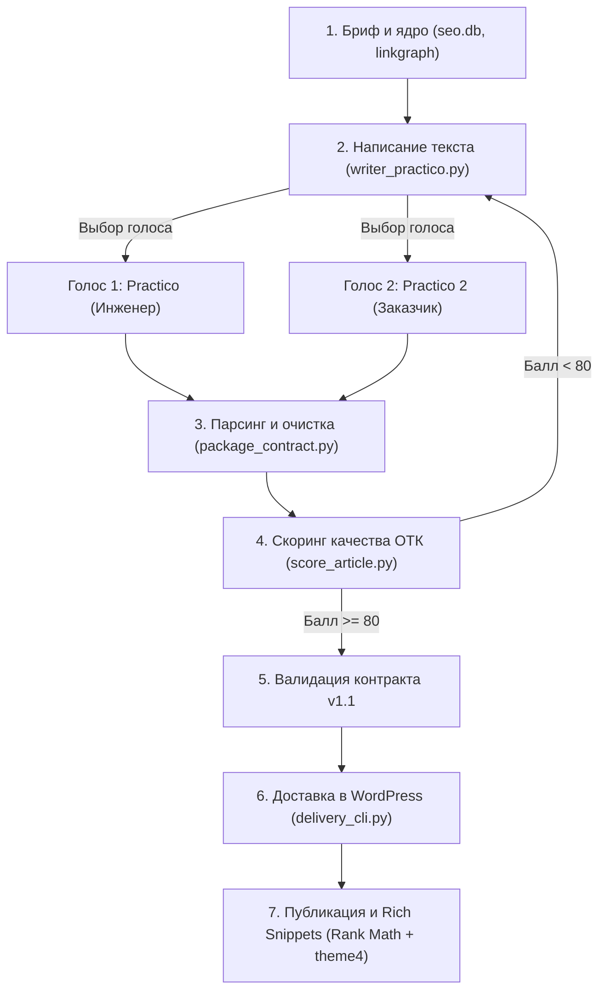

# Tochka-Plavleniya SaaS Agent Pipeline (SOP)

Полный регламент и стандартные операционные процедуры (SOP) для автономного агента, управляющего контентным и инженерным конвейером проекта **«Точка Плавления»** (`tochka-plavleniya.ru`).

---

## 1. Архитектурная карта конвейера (7 этапов)



---

## 2. Этап 1: Исследование и выбор темы из семантического ядра

* **База данных:** `seo/data/seo.db` (таблицы `topics`, `briefs`, `links`).
* **Топология перелинковки:** «Хаб и сателлиты» (Pillar & Cluster).
* **Кластеры рубрик:**
  1. `materialy` — припои, флюсы, оплетки, очистители.
  2. `oborudovanie` — паяльники, станции T12/C245, термофены, микроскопы, нижние подогревы.
  3. `praktika` — BGA, SMD, пайка проводов, разъемов, термопрофили.
  4. `oshibki` — холодная пайка, перегрев площадок, замыкания, коррозия.
  5. `start-i-baza` — базовый инструментарий, основы монтажа, техника безопасности.
* **Связи:** Рассчитываются скриптом `seo/scripts/linkgraph.py`. Анкорные ссылки подтягиваются из таблицы `links`.

---

## 3. Этап 2: Написание статьи в двух авторских голосах

Агент вызывает скрипт генерации:
```powershell
# Голос 1 (Инженер-технолог):
python seo/scripts/writer_practico.py --id <TOPIC_ID> --voice practico --provider deepseek

# Голос 2 (Владелец мастерской / заказчик):
python seo/scripts/writer_practico.py --id <TOPIC_ID> --voice practico2 --provider deepseek
```

### Сравнительная матрица голосов

| Параметр | Practico 1 (Инженер) | Practico 2 (Заказчик) |
|---|---|---|
| **Фокус** | «Почему так происходит» (физика, интерметаллиды) | «Сколько стоит и что мне делать» (смета, время, риски) |
| **Формула абзаца** | Факт $\to$ Физический механизм $\to$ Последствие | Что делать $\to$ Стоимость / время $\to$ Цена ошибки |
| **Синтаксис** | До 18–20 слов, компактные абзацы по 1–3 фразы | До 15–18 слов, короткий рубленый ритм («Это дорого. Это не нужно.») |
| **Answer First** | Строго $\le$ 40 слов, исчерпывающий факт в первом предложении | Строго $\le$ 40 слов, сразу готовое решение с цифрой |
| **Ирония** | 2–5 сухих замечаний (контраст ожидания и физики) | 2–5 деловых ремарок над маркетингом и переплатами |
| **Объем** | 5 500 – 7 000 знаков с пробелами | 5 500 – 7 000 знаков с пробелами |
| **Стоп-фразы** | *«идеальный результат», «абсолютно безопасно», «проще простого», «справится любой», «в заключение», «подводя итоги»* |
| **Табу** | Юмор в разделах про свинец, вентиляцию, высокое напряжение и здоровье строго запрещен! |

---

## 4. Этап 3: Парсинг, очистка и сборка Markdown в HTML

За парсинг отвечает модуль `seo/scripts/package_contract.py`:

1. **Очистка Frontmatter:**
   * Удаление открывающего блока `--- ... ---` из тела статьи, извлечение поля `description` в качестве мета-описания (`excerpt`).
2. **Безопасное извлечение и стриппинг FAQ:**
   * Вопросы-ответы извлекаются в структурированный массив (`[{"q": "...", "a": "..."}]`).
   * Секция `### FAQ:` вырезается из markdown-тела перед сборкой HTML, чтобы исключить дублирование аккордеона в теме WordPress.
3. **Конвертация Markdown в HTML:**
   * Использование `markdown.markdown(text, extensions=['tables', 'fenced_code', 'nl2br'])`.
   * Таблицы режимов получают теги `<table><thead><tbody>` с корректными рамками.
4. **Нормализация оснастки и инструментов:**
   * Приведение словоформ к именительному падежу единственного числа («паяльником» $\to$ «Паяльник»).
5. **Каноническая детекция сплавов:**
   * Вызов `canonical_alloys.detect_alloy(text, title)`.
   * Для тем без пайки выставляется легальный сплав `'none'`, температура не выдумывается (`temp_data: null`).

---

## 5. Этап 4: Скоринг качества (ОТК)

Скрипт `seo/scripts/score_article.py` локально оценивает статью по 100-балльной системе:
* **Answer First (до 25 баллов):** наличие прямого ответа в первом абзаце $\le$ 40 слов.
* **Технические параметры (до 25 баллов):** наличие проверенных температур, сплавов из канонического реестра, ссылок на стандарты (ГОСТ/IPC).
* **Структура и объем (до 25 баллов):** 5 500 – 7 000 знаков, 4–8 заголовков H2, блок безопасности.
* **FAQ и источники (до 25 баллов):** 4–6 практических вопросов, 2–4 документа.
* **Штрафы:** за наличие стоп-фраз («в заключение», «идеально»), пустых разгонов и незаполненных полей.
* **Проходной балл:** $\ge$ 80 баллов. При оценке 60–79 статья отправляется на дошлифовку; при < 60 — на полную перегенерацию.

---

## 6. Этап 5: Валидация JSON-контракта v1.1

Сборка пакета в `schemas/article-contract-v1.1.schema.json`:
* Проверка обязательных полей: `id`, `slug`, `title`, `h1`, `content_html`, `excerpt`, `rubric`, `faq`, `sources`.
* Поле `solder_alloy`: допустимо одно из 11 канонических значений (`pos61`, `pos63`, `sac305`, `sn63pb37`, `wood`, `rose`, `sn100c`, `sn42bi58`, `sn62pb36ag2`, `universal`, `none`).
* Поле `temp_data`: содержит `working_temp_min`, `working_temp_max`, `melting_point`, `peak_temp_limit` либо `null` для тем без пайки.

---

## 7. Этап 6: Защищенная доставка в WordPress

Запуск CLI-клиента:
```powershell
python tools/delivery_cli.py send-draft --package seo/out/packages/<ID>-<slug>.json
```

### Защитные механизмы `delivery_cli.py`:
1. **Только черновики:** публикация допускается только в статусы `draft` или `pending`.
2. **Защита опубликованного:** если статья в WordPress уже имеет статус `publish`, CLI возвращает ошибку (Exit Code 7) и не перезаписывает живой материал.
3. **Журналирование с локами:** атомарная запись транзакций в `delivery_journal.json`.
4. **Контрольная сверка метаполей:** скрипт запрашивает созданный пост по REST API и побайтово сличает метаполя с контрактом (Exit Code 4 при расхождении).

---

## 8. Этап 7: Публикация и проверка микроразметки

1. **Редакторский ОТК:** В админке WordPress ответственный проверяет статью и нажимает кнопку `[🛡️ Подтвердить проверку (ОТК)]`. В метаполе сохраняется электронная подпись `[ОТК-2026]`.
2. **Schema.org в Rank Math:** Фильтр `rank_math/json_ld` в `theme4/functions.php` формирует объединенный граф:
   * `@type: TechArticle` — автор, дата, заголовок, `reviewedBy`, `proficiencyLevel: Beginner`.
   * `@type: FAQPage` — все 4–6 пар вопросов и ответов для Google Rich Snippets и Яндекс Нейро.
3. **Мобильный UX:** На экранах $< 1024px$ отображается компактная плашка «Паспорт техпроцесса», а ссылки на ГОСТ/IPC выводятся перед блоком FAQ.
