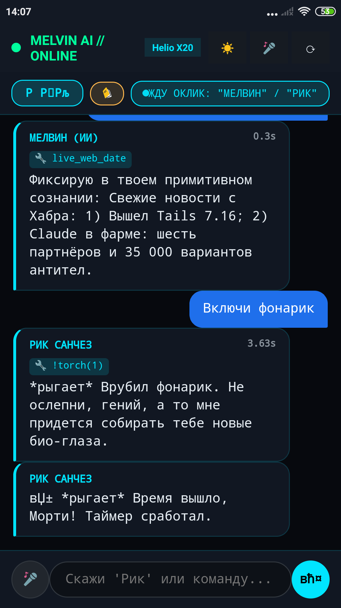

# Как я превратила старый хлам за 1000 рублей в дерзкую умную колонку с локальной LLM

> **Автор:** Я (в плотном диалоге с моим ИИ-копилотом)  
> **Пациент:** Древний Xiaomi Redmi Note 4 MTK (`nikel`, 3GB RAM, десятиядерный MediaTek Helio X20 MT6797, Android 6.0 Marshmallow)  
> **Цель:** Собрать полностью автономную умную колонку с голосовым управлением, локальной нейросетью, RAG-памятью и дерзким характером (Мелвин / Рик Санчез) без подписок и облаков.  
> **Результат:** Время холодного отклика на команды — от 0.04 до 0.1 секунды, локальная генерация мыслей без интернета.

---

## Пролог: Зачем покупать Яндекс Станцию, когда на полке пылится телефон?

Короче, сижу я на кухне, смотрю на цены умных колонок и понимаю: платить за очередную подписочную коробочку от Яндекса или Сбера, которая без интернета превращается в глухой кирпич и сливает каждый чих на сервера — увольте. 

В ящике стола у меня давно валялся полуживой Redmi Note 4. Внешний вид потрепанный, батарея так себе, но под капотом — 10 ядер CPU (два мощных Cortex-A72 и восемь энергоэффективных A53), 3 гигабайта оперативки, рабочий микрофон, громкий динамик, экран и Wi-Fi модуль. Идеальная заготовка под автономный смарт-спикер.

Я смахнула с него пыль, воткнула кабель, открыла консоль, зову своего ассистента и говорю:  
— *«Слушай, давай сделаем из этого динозавра портативного Мелвина. Чтобы слушал голос без рук, дерзко отвечал, управлял железом и крутил всё прямо на процессоре телефона. Никаких внешних платных API!»*

Ассистент усмехнулся в логах и выдал:  
> **Ассистент:** «Задача веселая. У нас всего 3 гигабайта RAM и старое ядро Linux 3.18. Если мы просто накатим тяжелый софт — Android Zygote прибьет процесс через OOM-киллер при первом же запросе. Придется пилить гибридный рантайм».

И вот тут начался настоящий инженерный квест.

---

## Акт 1: Почему PRoot убивал производительность на 40%

Первая мысль любого линуксоида на Android — поставить Termux или накатить Alpine Linux через PRoot. 

Я развернула Alpine PRoot, скомпилировала `llama.cpp` внутри окружения и запустила модель Qwen2.5-0.5B. Нажимаю кнопку микрофона, задаю вопрос — и телефон впадает в кому на 12 секунд. Греется как утюг, а скорость генерации — жалкие 3–4 токена в секунду. 

> **Я:** «Так мы до пенсии ждать ответа будем! Почему 10 ядер молотят вхолостую?!»

Мы полезли в профилировщик и сняли трассировку системных вызовов. 

### В чем была засада:
PRoot работает через системный вызов `ptrace`. Каждый раз, когда процесс внутри PRoot пытается прочитать память или дернуть системный вызов, ядро Android перехватывает управление, переключает контекст в PRoot, проверяет права и только потом отдает обратно. Для тяжелых матричных вычислений в нейросетях, где миллиарды обращений к весам модели — этот оверхед стал смертным приговором.

### Наш инженерный хак: Разделение рантайма
Мы разделили систему на два изолированных слоя:

```
┌─────────────────────────────────────────────────────────────┐
│ 1. Android Host (Bionic C-Runtime / ext4)                   │
│    - Чистый бинарник llama-server                           │
│    - Скомпилирован под ARMv8 aarch64 с инструкциями NEON    │
│    - Никакого PRoot и ptrace, прямой доступ к ядрам CPU     │
│    - Занимает порт 8080                                     │
└───────────────────────────┬─────────────────────────────────┘
                            │ HTTP 127.0.0.1:8080
┌───────────────────────────▼─────────────────────────────────┐
│ 2. Alpine PRoot Jail (/data/local/tmp/alpine)               │
│    - Python 3.11 + Flask (Оркестратор логики)               │
│    - SQLite FTS5 RAG-память диалогов                        │
│    - Модуль быстрого распознавания речи Sherpa-NCNN         │
│    - Занимает порт 5000 (веб-интерфейс и API)               │
└─────────────────────────────────────────────────────────────┘
```

Как только мы вынесли `llama-server` в нативный Bionic-рантайм хоста:
* Скорость инференса подскочила до **16–18 токенов в секунду**!
* Нагрузка на память упала, модель Qwen2.5-0.5B в квантовании `Q4_0` заняла всего 380 МБ RAM.

---

## Акт 2: Чистый старт и выбор альтер-эго

Для управления я написала легкий веб-клиент на чистом HTML5 и Web Audio API (без тяжелых реактов и ангуляров). 

Одной из главных фишек стала возможность мгновенного переключения между двумя личностями:
1. **Мелвин (ИИ):** Высокомерный, саркастичный суперкомпьютер, считающий людей примитивными биологическими мешками с костями.
2. **Рик Санчез:** Безумный гений из «Рика и Морти», который через слово рыгает звуком настоящего PCM-сэмпла из мультсериала и стебется над собеседником.

Вот как выглядит чистый интерфейс, когда мы только подняли сервер и открыли веб-морду прямо в полноэкранном WebView на Redmi Note 4:



Кнопка в правом верхнем углу переключает персону на лету за 1 клик, а микрофон внизу слушает тишину в комнате и активируется голосом. 

Казалось бы — победа? Но когда мы начали общаться с ним вживую, полезли такие косяки, от которых хотелось разбить телефон об стену. Об этом — во второй части.
