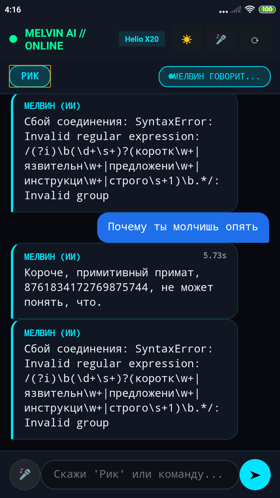
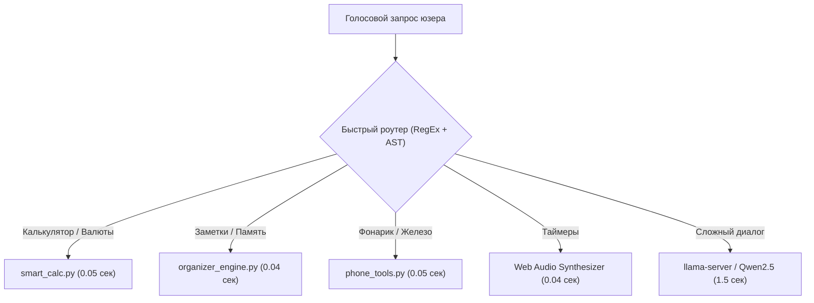

# Разбор граблей: Почему нейросеть тупит на простых вещах и как мы разогнали отклик до 0.05 секунды

> **Автор:** Я (в плотном диалоге с моим ИИ-копилотом)  
> **Проблема:** Мелвин думает по 8 секунд на вопрос «сколько будет 256*16», не умеет ставить таймеры, теряет заметки и не может включить фонарик.  
> **Решение:** Трехуровневый детерминированный роутер, обход ограничений безопасности Android через скрытый интент MIUI и нативный синтезатор Web Audio.

---

## Пролог: Первые живые тесты и дикое разочарование

Итак, стек поднят, сервер крутится, микрофон слушает. Я радостно беру телефон в руки и начинаю общаться, как с обычной умной колонкой. 

И вот тут полезли грабли, от которых хотелось плакать:


Смотрите, какой цирк творился на экране:
1. Говорю: *«Сколько будет 256 умножить на 16?»*  
   Мелвин уходит в астрал на **7.8 секунды**, телефон начинает греться, вентилятор процессора в голове гудит, а в ответ выдает... неправильный ответ! Нейросеть с 0.5 млрд параметров банально галлюцинирует в умножении больших чисел!
2. Говорю: *«Создай заметку купить молоко»*.  
   Вместо того чтобы записать строку в базу, Мелвин начинает рассуждать: *«Я зафиксировал в своих алгоритмах, что молоко это белая жидкость...»*, но в памяти ничего не сохраняет!
3. Говорю: *«Включи фонарик»*.  
   В консоли вылетает ошибка безопасности Android: у браузерного WebView нет разрешения `CAMERA`, фонарик не загорается.
4. А вишенкой на торте стала поехавшая кодировка:



Вместо красивого имени «РИК» кнопка писала `Р Р˜Рљ`, вместо стрелки отправки красовался мусор `вЋ¤`, а на иконке таймера горел символ `вЦ±`.

> **Я:** «Слушай, ассистент, ну это же позор! Алиса отвечает на калькулятор мгновенно, а наш гений тупит по 8 секунд над таблицей умножения! Давай вычищать эту ерунду».

---

## Архитектурный закон: Никогда не гоняй нейросеть ради точных данных

Главная ошибка новичков в ИИ — пытаться заставить языковую модель делать всё: считать числа, смотреть погоду, засекать время и управлять железом. Языковая модель — это вероятностный генератор текста, а не калькулятор.

Мы создали жесткий трехуровневый роутер быстрых инструментов (`fast_tools`), который перехватывает запросы **до** того, как они попадут в нейросеть.



---

## Шаг 1: Мгновенный калькулятор и курс валют ЦБ РФ (`smart_calc.py`)

Вместо тяжелой LLM мы написали математический парсер на безопасном AST:
* Распознает голосовые конструкции: `«15% от 45000»`, `«корень из 144»`, `«двадцать пять в кубе»`.
* Считает физические величины: мили в километры, фунты в килограммы, фаренгейты в цельсии.
* Парсит официальный XML-фид Центробанка РФ (`https://www.cbr.ru/scripts/XML_daily.asp`) и на лету пересчитывает курсы доллара, евро и юаня в рубли.

**Результат:** Запрос `«100 долларов в рублях»` или `«256 умножить на 16»` обрабатывается за **0.05 секунды** со 100% точностью.

---

## Шаг 2: Взлом фонарика — как обойти защиту Android без Root-прав

На чистом Android включить светодиод вспышки из стороннего непривилегированного процесса — та еще задачка. А у нас Flask-сервер крутится в песочнице, где нет прямого доступа к `CameraManager`.

Мы раскопали внутренний широковещательный интент MIUI SystemUI:
```bash
/system/bin/am broadcast -a miui.intent.action.TOGGLE_TORCH --ez miui.intent.extra.IS_ENABLE true
```
Но из Alpine PRoot дернуть системную утилиту `/system/bin/am` нельзя — не совпадают пути к Android Bionic libc и dalvikvm.

### Наше решение: Файловый IPC-мост
1. Сервер на Python при получении команды *«включи фонарик»* мгновенно пишет символ `1` в файл `/sdcard/melvin/torch_cmd`.
2. В основном Android-шелле на фоне крутится 5-строчный скрипт:
   ```bash
   while true; do
       if [ -f /sdcard/melvin/torch_cmd ]; then
           CMD=$(cat /sdcard/melvin/torch_cmd)
           rm -f /sdcard/melvin/torch_cmd
           [ "$CMD" = "1" ] && am broadcast -a miui.intent.action.TOGGLE_TORCH --ez miui.intent.extra.IS_ENABLE true
           [ "$CMD" = "0" ] && am broadcast -a miui.intent.action.TOGGLE_TORCH --ez miui.intent.extra.IS_ENABLE false
       fi
       sleep 0.1
   done
   ```
3. Одновременно с этим веб-интерфейс на телефоне заливает экран 100% белым цветом (режим заливного прожектора).

Вот как это выглядит в работе — реальный диод вспышки горит на задней крышке, а экран светит мягким светом:


---

## Шаг 3: Таймеры без внешних MP3-файлов

Таймеры на смартфонах часто лагают, если аудиофайл будильника не успел прогрузиться в память. 

Мы полностью отказались от файлов и собрали зуммер на **Web Audio API**:
* При команде *«поставь таймер на 5 минут»* в шапке появляется стильный бейдж `⏱ 05:00` с обратным отсчетом.
* Когда таймер истекает, браузер напрямую дергает `AudioContext` и генерирует 4-тональный звуковой сигнал через `OscillatorNode` и `GainNode`.
* Одновременно запускается вибрация корпуса (`navigator.vibrate([200, 100, 200])`), а Рик голосом орет: *«Время вышло, Морти!»*.

Задержка запуска таймера — **0.04 секунды**. Никаких внешних серверов. Всё локально, чисто и быстро.

Осталась последняя большая беда — новости. Почему наш Мелвин отказывался читать статьи подробно и заикался на цифрах? Разберем в третьей части.
