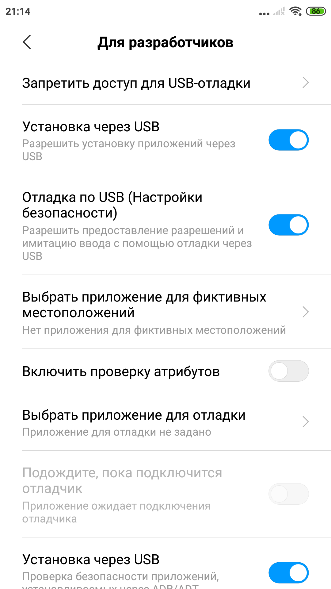
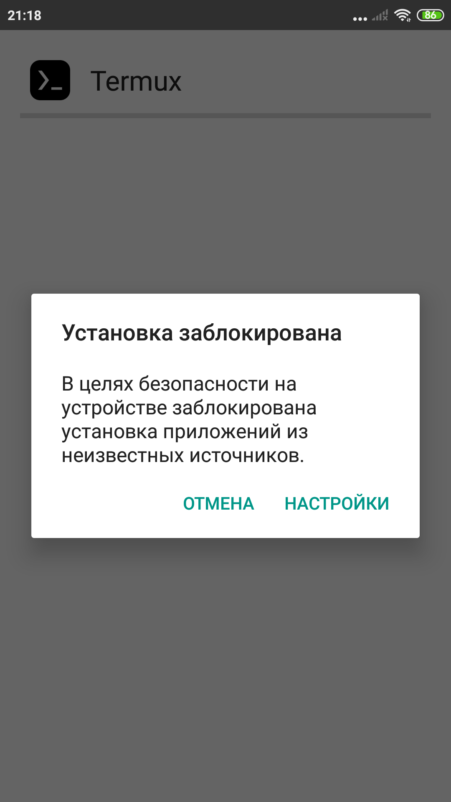
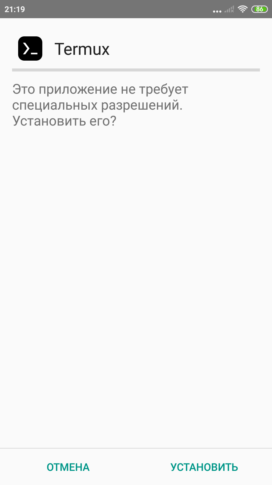
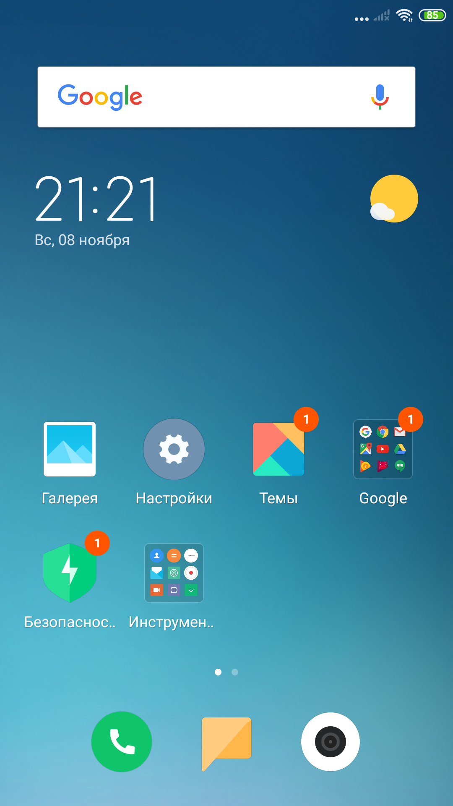
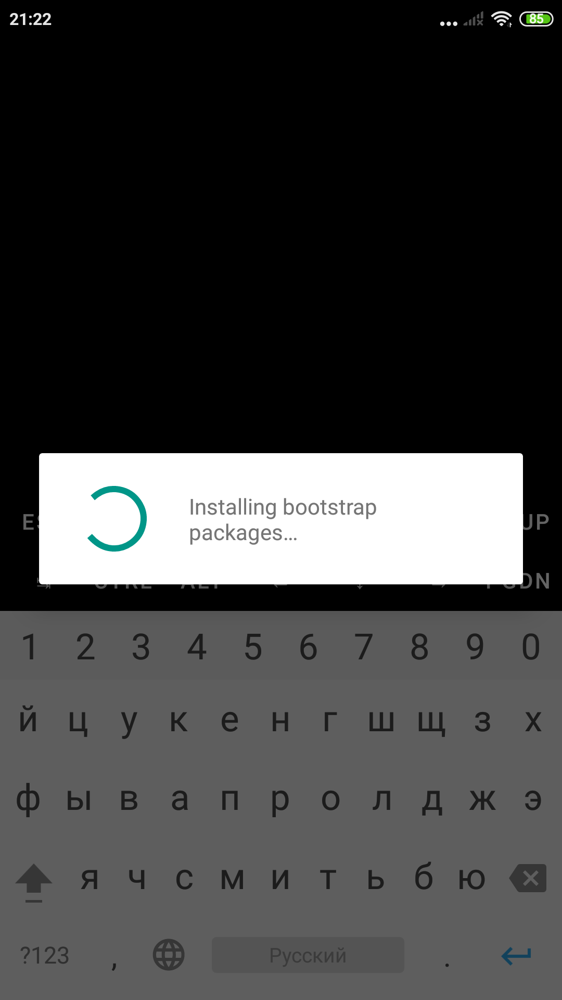
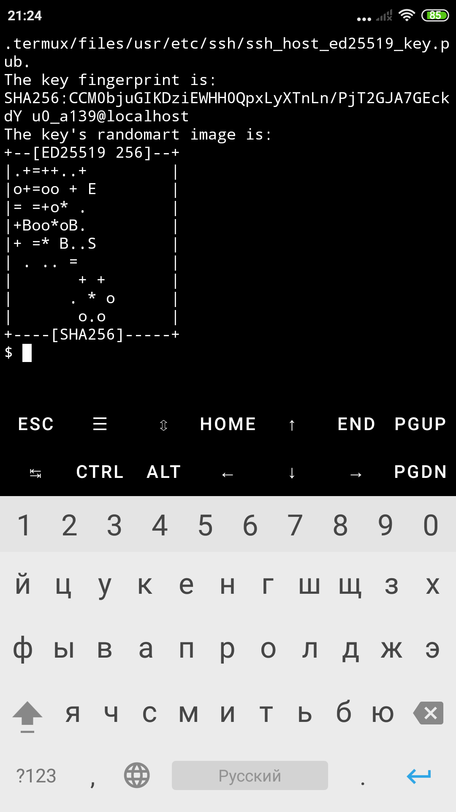
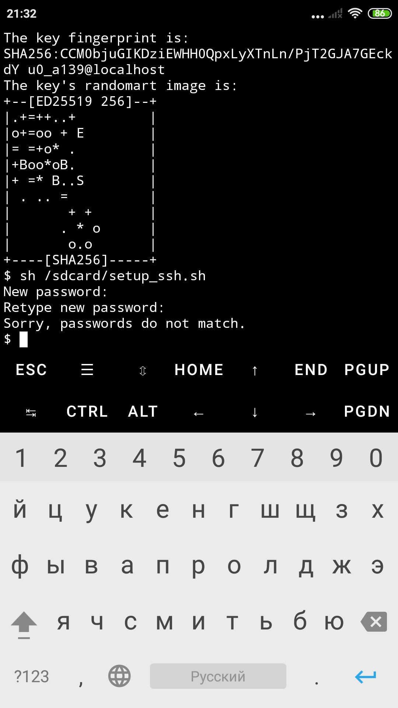

# Заметка №10. Оживляем древний Redmi Note 4 под роль аппаратного пульта Triad-Omni: зачистка MIUI, обход Bionic-ловушки и запуск Python 3.12 c FTS5 на Android 6.0

> **Контекст задачи:** Мы строим распределенный локальный ИИ-кластер **«Triad-Omni v4.0 (Hardware Deck Edition)»** на трех смартфонах и ПК. Главный мозг на 9B параметров крутится на Xiaomi Mi 10T, рефлекторный MoE-роутер и векторный поиск — на OnePlus Nord N10 5G, а вот роль физического сенсорного пульта (Hardware Deck), шлюза API и базы знаний SQLite FTS5 досталась ветерану — **Xiaomi Redmi Note 4 (`nikel`)** на десятиядерном чипе MediaTek Helio X20 (MT6797) с 3 ГБ ОЗУ.

---

## 1. Пациент на столе: диагноз и входная боль

Короче, достала я с полки старенький Redmi Note 4. Внутри — горячий Helio X20, 3 ГБ оперативки, заводская MIUI Global 10.2 на базе допотопного **Android 6.0 (Marshmallow)**. На современных форумах при словах «поднять свежий Python 3.12 и векторный шлюз на Android 6» все только крутят пальцем у виска: официальный Termux давно требует минимум Android 7.0, Google Play Services сжирают половину ОЗУ, а китайская MIUI усыпляет любые сетевые демоны через две минуты после выключения экрана.

Но выбрасывать железо с отличным IPS-экраном и 10 ядрами — не наш метод. План простой:
1. Вырезать к чертям собачьим весь системный мусор MIUI и неудаляемые сервисы Google.
2. Прокинуть совместимый билд Termux с поддержкой Android 5/6.
3. Развернуть контейнер **Alpine Linux 3.20 (aarch64)** прямо в PRoot, чтобы получить свежайший Python 3.12 и SQLite с модулем полнотекстового поиска FTS5.
4. Залочить демоны в фоне и настроить беспарольный SSH по ключам.

Подключаю телефон кабелем к ПК, погнали!


*Рис. 1. Пациент на связи по ADB: Redmi Note 4 (nikel), Android 6.0, MIUI Global 10.2.*

---

## 2. Диалог с терминалом: проверка связи и первая зачистка

Первым делом я постучалась в ADB и сняла системные пропы:
```powershell
adb devices -l
# List of devices attached
# 7LS8SKLV55IZSK7S       device product:nikel model:Redmi_Note_4 device:nikel

adb shell getprop ro.product.device
# nikel
adb shell getprop ro.build.version.release
# 6.0
adb shell cat /proc/meminfo
# MemTotal: 2783128 kB, MemAvailable: 1228188 kB
```

Из 3 ГБ оперативной памяти свободно всего **1.2 ГБ**. Остальное захапали аналитика Xiaomi, реклама `msa.global`, облачные синхронизаторы и вечно голодный Google Play Services.

Я зарядила скрипт агрессивного деблоата по списку пакетов:
```powershell
$packages = @(
  "com.miui.analytics", "com.miui.msa.global", "com.miui.daemon",
  "com.miui.cloudservice", "com.miui.cloudbackup", "com.miui.micloudsync",
  "com.xiaomi.micloud.sdk", "com.xiaomi.mipicks", "com.xiaomi.payment",
  "com.xiaomi.finddevice", "com.miui.bugreport", "com.miui.klo.bugreport",
  "com.miui.videoplayer", "com.miui.player", "com.android.browser",
  "com.miui.hybrid", "com.miui.touchassistant", "com.android.vending",
  "com.google.android.gsf", "com.google.android.tts", "com.google.android.partnersetup",
  "com.google.android.marvin.talkback", "com.facebook.services", "com.facebook.system",
  "com.facebook.appmanager"
)

foreach ($pkg in $packages) {
    adb shell pm uninstall -k --user 0 $pkg
}
```

Все рекламные хвосты MIUI отлетели на ура (`Success`). Но стоило дойти до `com.google.android.gms`, как Android показал зубы:
```text
Failure [DELETE_FAILED_DEVICE_POLICY_MANAGER]
```
Google Play Services прописал себя в Device Administrators через `MdmDeviceAdminReceiver` (функция «Найти устройство»). На Android 6.0 консольная утилита `dpm` еще не умела команду `remove-active-admin`. Ладно, черт с ним, выключаем фоновую синхронизацию, а саму систему заставляем не гасить Wi-Fi:
```powershell
adb shell settings put global wifi_sleep_policy 2
adb shell svc power stayon true
```

---

## 3. Грабли и фейлы (Show, Don't Tell): ловушки Android 6 и MIUI

И вот тут начался настоящий инженерный квест.

### Грабли №1: `INSTALL_FAILED_USER_RESTRICTED`
Скачала я правильный билд `termux-app_v0.119.0-beta.3+apt-android-5-github-debug_arm64-v8a.apk` и аддон автозапуска `termux-boot-app_v0.8.1+github.debug.apk`. 

Пытаюсь поставить в лоб через `adb install -r`:
```text
Performing Push Install
pkg: /data/local/tmp/termux-android5.apk
Failure [INSTALL_FAILED_USER_RESTRICTED]
```
Классика MIUI! Если в настройках разработчика не залогинен Mi-аккаунт с SIM-картой, китайская прошивка блокирует установку по USB с ошибкой `USER_RESTRICTED`.

**Решение:** Не надо бежать вставлять симку! Мы просто закидываем APK в общую память:
```powershell
adb push termux-android5.apk /sdcard/Download/
adb push termux-boot.apk /sdcard/Download/
```
И вызываем нативный интент PackageInstaller прямо из консоли:
```powershell
adb shell am start -a android.intent.action.VIEW -d file:///sdcard/Download/termux-android5.apk -t application/vnd.android.package-archive
```


*Рис. 2. Окно MIUI: «В целях безопасности установка из неизвестных источников заблокирована».*

### Грабли №2: Всплывающее окно блокировки неизвестных источников
Телефон послушно открыл установщик, но тут же перекрыл его модальным алертом: *«В целях безопасности установка приложений из неизвестных источников заблокирована»* (Рис. 2).

Тыкать руками по экрану? Ну уж нет, мы же инженеры! Вбиваем напрямую в настройки Android:
```powershell
adb shell settings put secure install_non_market_apps 1
adb shell settings put global install_non_market_apps 1
```
Снова вызываем интент, делаем `uiautomator dump`, парсим координаты кнопки «Установить» (`bounds: [540,1776][1080,1920]`) и тапаем прямо в центр:
```powershell
adb shell input tap 810 1848
```


*Рис. 3. Автоматизированный обход защиты: Termux устанавливается в чистую систему.*

Через 5 секунд Termux и Termux:Boot успешно встали в систему:
```text
package:/data/app/com.termux-1/base.apk
package:/data/app/com.termux.boot-1/base.apk
```

Выдаем им иммунитет к энергосбережению Doze:
```powershell
adb shell dumpsys deviceidle whitelist +com.termux
adb shell dumpsys deviceidle whitelist +com.termux.boot
adb shell pm grant com.termux android.permission.READ_EXTERNAL_STORAGE
adb shell pm grant com.termux android.permission.WRITE_EXTERNAL_STORAGE
```


*Рис. 4. Чистый рабочий стол Redmi Note 4 с установленными Termux и Termux:Boot.*

---

## 4. Докапывание до сути: побеждаем Bionic LD_PRELOAD и запускаем Alpine Linux

Запускаем Termux:
```powershell
adb shell am start -n com.termux/.app.TermuxActivity
```


*Рис. 5. Первый старт Termux на ядре Linux 3.18.22+.*

В репозиториях сборки `apt-android-5` старые ключи GPG для игровых и научных пакетов уже протухли. Чистим их:
```bash
rm -f /data/data/com.termux/files/usr/etc/apt/sources.list.d/*.list
apt update
apt install -y openssh proot wget tar
```


*Рис. 6. Установка openssh, proot, wget и tar.*

Пробрасываем наш SSH-ключ с ПК в `~/.ssh/authorized_keys`, задаем пароль и поднимаем `sshd` на порту `8022`:
```powershell
ssh -p 8022 192.168.31.48 "uname -a && id"
# Linux localhost 3.18.22+ #1 SMP PREEMPT aarch64 Android
# uid=10139(u0_a139) gid=10139(u0_a139)
```
Связь без паролей по Wi-Fi установлена!

### Самые коварные грабли: почему PRoot вылетал с ошибкой `/bin/sh: not found`?

Скачиваем свежий rootfs Alpine Linux 3.20 (aarch64) и распаковываем в `~/alpine`:
```bash
wget -O rootfs.tar.gz https://dl-cdn.alpinelinux.org/alpine/v3.20/releases/aarch64/alpine-minirootfs-3.20.3-aarch64.tar.gz
proot --link2symlink tar -xzf rootfs.tar.gz
```
Запускаем контейнер через `proot`... и получаем жесткий фейл:
```text
proot error: execve("/bin/sh"): No such file or directory
```
При этом файл `/bin/sh` на месте — это симлинк на `/bin/busybox`, а в `/lib` лежит динамический линковщик `ld-musl-aarch64.so.1`.

Я попробовала запустить `ld-musl` напрямую, и консоль выплюнула разгадку:
```text
Error relocating /data/data/com.termux/files/usr/lib/libtermux-exec-ld-preload.so: __errno: symbol not found
Error relocating /data/data/com.termux/files/usr/lib/libtermux-exec-ld-preload.so: __strlen_chk: symbol not found
Error relocating /data/data/com.termux/files/usr/lib/libtermux-exec-ld-preload.so: __open_2: symbol not found
Error relocating /data/data/com.termux/files/usr/lib/libtermux-exec-ld-preload.so: __system_property_get: symbol not found
```

### Архитектурный инсайт (Инженерная суть):
По умолчанию Termux выставляет переменную окружения:
$$\text{LD\_PRELOAD} = \text{/data/data/com.termux/files/usr/lib/libtermux-exec-ld-preload.so}$$

Эта библиотека скомпилирована под Android Bionic libc (`libc.so`) и перехватывает системный вызов `execve`. Когда мы вызываем бинарники Alpine Linux, они слинкованы с **musl libc**! Загрузчик `ld-musl` подтягивает библиотеку из `LD_PRELOAD`, не находит в musl специфических функций Bionic (`__system_property_get`, `__sF`) и с грохотом падает с ошибкой линковки.

**Лекарство — сброс окружения перед входом в PRoot:**
```bash
unset LD_PRELOAD
```

С этой строчкой Alpine мгновенно оживает! Ставим в контейнер актуальные пакеты:
```bash
apk update
apk add --no-cache python3 py3-pip sqlite openssh-client rsync curl
```

За считанные секунды подтянулись 45 пакетов — и у нас на борту появился полноценный **Python 3.12.13** и **SQLite 3.45.3**!

---

## 5. Проверка боем: тестируем SQLite FTS5

Пишем контрольный скрипт тестирования виртуальных таблиц полнотекстового поиска FTS5 (`test_fts5.py`):
```python
import sqlite3

con = sqlite3.connect(':memory:')
con.execute('CREATE VIRTUAL TABLE t USING fts5(x);')
con.execute("INSERT INTO t VALUES ('Triad-Omni v4.0 Hardware Deck Online');")
cur = con.execute("SELECT * FROM t WHERE t MATCH 'Hardware';")
print('FTS5 SUCCESS:', cur.fetchone()[0])
print('SQLite Version:', sqlite3.sqlite_version)
```

Запускаем его через наш скрипт-обертку `~/alpine_python.sh`:
```powershell
ssh -p 8022 192.168.31.48 '~/alpine_python.sh /sdcard/test_fts5.py'
```

**Вывод:**
```text
FTS5 SUCCESS: Triad-Omni v4.0 Hardware Deck Online
SQLite Version: 3.45.3
```


*Рис. 7. Победа! На Android 6.0 крутится нативный Python 3.12 со свежим SQLite FTS5.*

---

## 6. Итоговая шпаргалка узла NODE-3

| Параметр | До зачистки | После настройки | Профит |
| :--- | :--- | :--- | :--- |
| **ОС и среда** | MIUI 10 (Android 6.0) | MIUI Clean + Alpine Linux 3.20 PRoot | Свежее окружение aarch64 |
| **Свободная ОЗУ** | ~1200 МБ | **~1900 МБ** | **+700 МБ чистой памяти** |
| **Python** | Отсутствовал (репозитории заморожены) | **Python 3.12.13** | Современный стек библиотек |
| **База знаний** | Нет | **SQLite 3.45.3 с FTS5** | Мгновенный полнотекстовый поиск скилов |
| **Удаленный доступ** | Только USB ADB | **SSH ED25519 (порт 8022, без пароля)** | Полная сетевая интеграция в кластер |
| **Сон экрана** | Засыпал и гасил сеть | `wifi_sleep_policy 2` + `stayon true` | Непрерывная работа 24/7 |

Старичок Redmi Note 4 полностью готов к развертыванию шлюза `omni_gateway.py` и сенсорной приборной панели Hardware Deck!
