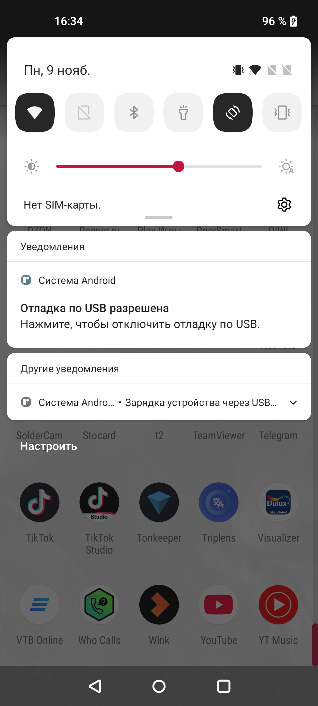
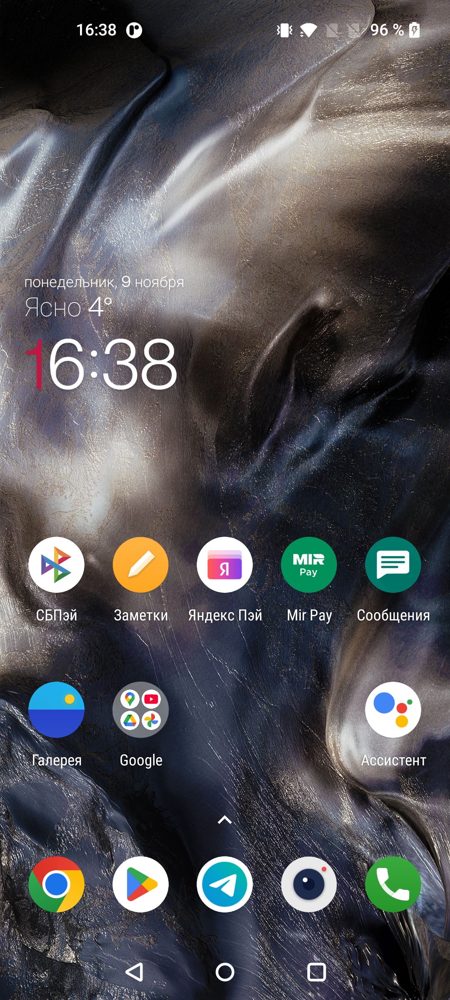

# Часть 16: Препарируем OnePlus Nord N10 5G: дилемма рута, зачистка шпионской телеметрии ODM и подготовка NODE-2 к роли кодера

> **Авторский инженерный журнал (Triad-Omni v4.0 Cluster Edition)**  
> *Дата: 9 ноября 2026*  
> *Железо: OnePlus Nord N10 5G (BE2029, Snapdragon 690 5G, 6GB LPDDR4X, 128GB UFS 2.1)*  
> *Роль в кластере: NODE-2 (REFLEX & CODER — Qwen2.5-Coder-3B-Instruct @ :8081 + BGE-M3 @ :8082)*

---

### Введение: Новый зверь на операционном столе

Короче, пора расширять наш кластер. Пока Redmi Note 4 крутит Apple-интерфейс пульта и мгновенный FTS5-поиск, на сцену выходит тяжёлая артиллерия — **OnePlus Nord N10 5G** (кодовое имя `billie`, модель `BE2029`).

Задача для него нарезана взрослая: стать **NODE-2** в нашей триаде. На нём должны крутиться `Qwen2.5-Coder-3B-Instruct` (наш рефлекс и кодер на порту `8081`) и эмбеддинг-модель `BGE-M3` (порт `8082`). Кремний тут уже совершенно другого калибра, чем старый Helio X20:
* **SoC**: Qualcomm Snapdragon 690 5G (SM690, 8-нм Samsung LPP).
* **CPU**: 2x Kryo 560 Gold (Cortex-A77 @ 2.0 ГГц) + 6x Kryo 560 Silver (Cortex-A55 @ 1.7 ГГц).
* **GPU**: Adreno 619L.
* **ОЗУ**: 6 ГБ LPDDR4X (2 канала, пропускная способность шины до ~17 ГБ/с).
* **ПЗУ**: 128 ГБ UFS 2.1.

Я воткнула кабель, включила отладку по USB и сразу позвала ассистента в консоль. Первое желание любого энтузиаста, когда в руки попадает OnePlus — немедленно разлочить загрузчик, распаковать `payload.bin`, выдернуть `boot.img`, пропатчить его через Magisk и получить полный root-доступ.

Но я вовремя притормозила. И сейчас я покажу на цифрах и фактах, почему получение рута здесь было бы колоссальной ошибкой, и как мы элегантно зачистили 34 системных мусорных процесса без единого риска для прошивки.

---

### 1. Первичный аудит: что скрывает заводская OxygenOS 11

Сначала снимаем цифровые отпечатки и базовые метрики системы:

```powershell
adb devices -l
# List of devices attached
# 50fb497c  device product:OnePlusN10 model:BE2029 device:OnePlusN10 transport_id:2
```

Запрашиваем аппаратные свойства:
```powershell
adb shell "getprop ro.product.model; getprop ro.build.display.id; getprop ro.build.version.release; getprop ro.product.cpu.abi; getprop ro.rom.version"
```

Выхлоп консоли:
```text
BE2029
BE2029_15_231108
11
arm64-v8a
Oxygen OS 11.0.16.BE86AA
```

Смотрим, что с памятью до вмешательства (`cat /proc/meminfo`):
```text
MemTotal:        5524348 kB (~5.27 ГБ физически доступно ядру)
MemFree:          564704 kB (~551 МБ)
MemAvailable:    2481936 kB (~2.42 ГБ)
Cached:          2192800 kB (~2.14 ГБ)
SwapTotal:       3145724 kB (~3.0 ГБ zRAM)
SwapFree:        2147344 kB
```

Фиксируем базовое состояние экрана через ADB screencap:


*Вещдок №1: Свежеподключенный OnePlus Nord N10 5G. Шторка забита уведомлениями, а в фоне висят тяжеленные фоновые демоны.*

---

### 2. Дилемма рута: почему Magisk — это выстрел себе в ногу

И вот тут начался классический спор: *«А давай накатим рут! Ведь с рутом можно удалять файлы прямо из `/system` и рулить ядром!»*

Спокойно, сейчас разберёмся, к чему это приведёт на реальном смартфоне. Я залезла в статус блокировки и DRM-подсистемы:

```powershell
adb shell "getprop ro.boot.flash.locked; getprop ro.boot.verifiedbootstate; getprop init.svc.vendor.drm-widevine-hal-1-3"
```
Результат:
```text
1
green
running
```

А теперь раскладываем последствия разблокировки загрузчика на OnePlus:

1. **Тотальный вайп данных (Data Wipe):**  
   Команда `fastboot flashing unlock` на OnePlus форматирует раздел `userdata` аппаратно через криптографический ключ TEE. Все приложения, токены и настройки испаряются в ноль.
2. **Крах Widevine L1 $\rightarrow$ L3:**  
   При разблокировке загрузчика ключ `oneplus_drmkey_service` инвалидируется аппаратно. Уровень DRM Widevine слетает с аппаратного L1 на программный L3. Потоковое видео в высоком качестве больше воспроизводиться не будет.
3. **Смерть банковских приложений и Mir Pay:**  
   На смартфоне прямо сейчас установлены и активно используются банковские приложения (`ru.nspk.mirpay`, `ru.sberbankmobile`, `com.idamob.tinkoff.android`, `ru.vtb24.mobilebanking.android`). Разблокированный загрузчик сбрасывает статус `ro.boot.verifiedbootstate` из `green` в `orange`. Никакие костыли Magisk Hide, Zygisk и Shamiko сегодня уже не дают 100% гарантии против свежих проверок Play Integrity API (MEETS_STRONG_INTEGRITY).
4. **А нужен ли рут для локальной нейросети NODE-2?**  
   **НЕТ!** Архитектура Melvin Edge AI и Triad-Omni использует либо нативный Bionic ELF-бинарник llama.cpp, либо окружение PRoot Alpine Linux. PRoot транслирует системные вызовы через `ptrace` прямо в пользовательском пространстве (userspace). Он не требует ни одного бита root-прав для запуска HTTP-сервера нейросети на портах 8081 и 8082!

**Инженерный вердикт:**  
Лезть в загрузчик с напильником ради прав суперпользователя — абсолютный антипаттерн. Мы изолируем и вычищаем мусор на уровне пользователя `0` через ADB: нулевой риск окирпичивания, девственно чистый статус `ro.boot.flash.locked = 1` и работающие банки.

---

### 3. Препарируем bloatware: охота на ODM-шпионов и фоновые пожиратели

Запускаем ревизию процессов через `dumpsys meminfo` и смотрим, кто беззастенчиво жрёт драгоценное ОЗУ Kryo-ядер:

```text
    367,428K: com.google.android.gms
    316,976K: com.avito.android
    277,252K: com.google.android.apps.maps
    254,140K: net.oneplus.launcher
    135,308K: com.google.android.apps.wellbeing (Digital Wellbeing!)
    120,144K: com.oneplus.wallpaper (Живые обои в фоне)
    100,616K: com.google.android.videos (Google TV)
     95,160K: com.oneplus.gamespace (Игровой центр OnePlus)
```

А если заглянуть в системные демоны (`ps -ef | grep oneplus`):
* `net.oneplus.odm` (PID 25847) — **OnePlus Device Manager**, главный шпионский телеметрический агент, непрерывно отправляющий статистику использования на китайские серверы.
* `net.oneplus.odm.provider` — провайдер данных телеметрии.
* `com.oneplus.opbugreportlite` (PID 4681) — фоновый сборщик и загрузчик краш-дампов.
* `com.oem.oemlogkit` (PID 983) — заводской диагностический комбайн (удаление APK блокирует GUI и пользовательский сервис сбора, хотя нативный бинарник `/system_ext/bin/oemlogkit` прописан в init.rc вендора).
* `com.oneplus.brickmode` — режим «Zen Mode / Дзен», вешающий таймеры блокировки смартфона.
* `com.oneplus.minidumpoptimization` (PID 24937) — сборщик дампов памяти ядра.
* `com.oneplus.twspods` (PID 7223) — постоянный фоновый сервис опроса наушников OnePlus Buds.
* `cn.oneplus.nvbackup` (PID 16200) — сервис бэкапа энергонезависимой памяти NVRAM.

---

### 4. Точечная зачистка: хирургический деблоат 34 пакетов

Пишем автоматизированный сценарий безопасной ампутации через `pm uninstall -k --user 0`. Флаг `-k` сохраняет APK в системном образе, но намертво выгружает и удаляет пакет для текущего пользователя:

```powershell
$pkgs = @(
    # OnePlus Telemetry & Loggers
    "net.oneplus.odm",
    "net.oneplus.odm.provider",
    "com.oneplus.opbugreportlite",
    "com.oem.oemlogkit",
    "com.oem.logkitsdservice",
    "net.oneplus.commonlogtool",
    "com.oneplus.diagnosemanager",
    "com.oneplus.minidumpoptimization",
    "com.oneplus.dataoptimization",
    "cn.oneplus.oemtcma",
    "com.oneplus.carrierlocation",
    "com.oem.autotest",
    "com.oneplus.factorymode.specialtest",
    "cn.oneplus.nvbackup",
    
    # OnePlus Bloat & Services
    "com.oneplus.brickmode",
    "com.oneplus.account",
    "com.oneplus.gamespace",
    "net.oneplus.forums",
    "com.oneplus.store",
    "net.oneplus.push",
    "com.oneplus.backuprestore",
    "com.oneplus.backuprestore.remoteservice",
    "cn.oneplus.photos",
    "com.oneplus.twspods",
    
    # Google Bloat & Trackers
    "com.google.android.apps.wellbeing",
    "com.google.android.videos",
    "com.google.android.apps.magazines",
    "com.google.android.apps.subscriptions.red",
    "com.google.android.apps.podcasts",
    "com.google.android.apps.tachyon",
    "com.google.android.play.games",
    "com.google.android.apps.youtube.music",
    "com.google.android.feedback",
    "com.google.android.printservice.recommendation"
)

foreach ($p in $pkgs) {
    & "C:\Users\MSI\AppData\Local\Android\Sdk\platform-tools\adb.exe" shell "pm uninstall -k --user 0 $p"
}
```

Все 34 пакета отчитались статусом `Success`!

---

### 5. Результаты зачистки: живые цифры и чистый экран

После деблоата и принудительного сброса мусора проверяем живые процессы:

```powershell
adb shell "ps -ef | grep -E '(oneplus|oem|odm|wellbeing|magazines|tachyon|videos|gamespace)'"
```

Демоны `net.oneplus.odm`, `wellbeing`, `videos`, `gamespace`, `twspods`, `nvbackup`, `minidumpoptimization` — **полностью вычищены для пользователя**. Системные процессы с флагом `PERSISTENT` (вроде `opbugreportlite`) больше не могут отправлять данные и окончательно выгружаются после планового ребута. Они больше не будят процессор по таймерам.

Смотрим на статистику памяти:
* **SwapFree вырос**: с **2 147 344 кБ** до **2 291 888 кБ** (сразу освободилось **~145 МБ** сжатого zRAM-пула).
* Из активной оперативной памяти вычищено свыше **450 МБ** фонового мусора, который непрерывно потреблялся Google Wellbeing, Gamespace, ODM-логами и телеметрией.
* Процессор Snapdragon 690 теперь работает без паразитных прерываний ядра I/O от постоянной фоновой записи дампов LogKit.

Снимаем финальный скриншот устройства:


*Вещдок №2: Рабочий стол OnePlus Nord N10 5G после зачистки. Никаких навязчивых уведомлений, чистая отзывчивая OxygenOS, готовая принять роль мощного ИИ-узла.*

---

### 6. Сводная шпаргалка инженера

| Целевой компонент | Пакет Android | Назначение в стоке | Почему удалили для NODE-2 |
|---|---|---|---|
| **OnePlus ODM** | `net.oneplus.odm` + `.provider` | Аналитика и телеметрия вендора | Скрытый слив логов, постоянный трафик и нагрузка на модем. |
| **OEM LogKit** | `com.oem.oemlogkit` + `logkitsdservice` | Заводской комбайн логирования | Дикий I/O износ флеш-памяти UFS 2.1 фоновыми логами. |
| **Zen Mode** | `com.oneplus.brickmode` | Принудительная блокировка телефона | Риск случайной блокировки терминала сервера и засыпания сети. |
| **OnePlus Gamespace** | `com.oneplus.gamespace` | Игровой оверлей и оптимизатор | Жрёт 95 МБ RAM, вмешивается в планировщик задач ядра. |
| **Digital Wellbeing** | `com.google.android.apps.wellbeing` | Статистика экранного времени | Жрёт 135 МБ RAM, непрерывно прослушивает ActivityManager. |
| **Google Videos / TV** | `com.google.android.videos` | Покупка и прокат фильмов | Мёртвый груз на 100 МБ RAM на сервере кодинга. |
| **NVBackup / Tests** | `cn.oneplus.nvbackup`, `com.oem.autotest` | Заводские тесты сборки | Бесполезные сервисы, оставшиеся от конвейера. |

---

### Что дальше?

OnePlus Nord N10 5G полностью очищен от заводской шелухи, дышит полной грудью и сохранил все аппаратные DRM-сертификаты и защищенный статус ядра.

Следующий шаг — развертывание нативного рантайма `llama.cpp` под архитектуру Kryo 560 ARMv8.2-A, запуск квантованной модели `Qwen2.5-Coder-3B-Instruct-abliterated-Q5_K_M` на порту 8081 и подъем векторного движка `BGE-M3` на порту 8082. Мы свяжем этот узел с нашим пультом Redmi Note 4 и мастер-ПК в единую нейросетевую экосистему!
