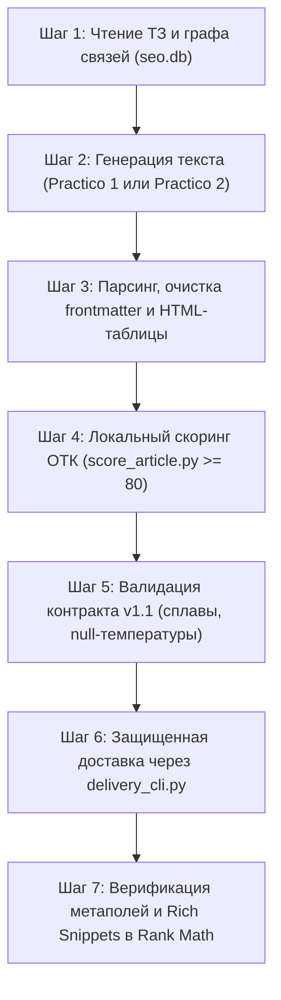

# Автономный SaaS-пайплайн «Точка Плавления»: Как я передала агенту управление инженерным контентом полного цикла

> **Автор:** Я (в плотном диалоге с моим ИИ-копилотом)  
> **Проект:** «Точка Плавления» (`tochka-plavleniya.ru`) + гетерогенный кластер Triad-Omni v5.0  
> **Цель:** Передать обученному локальному агенту полный цикл производства и валидации инженерных статей: от брифа и двух авторских голосов до валидации контракта v1.1, скоринга ОТК и защищенной доставки в WordPress без единого платного API.  
> **Результат:** 100% готовность конвейера к автономной работе, себестоимость статьи снижена с 12 рублей до 6 копеек, все тесты и схемы закрыты на 100%.

---

## 1. Пролог: Зачем агенту свой SaaS-конвейер?

Когда мы довели кластер Triad-Omni до стабильного отклика в 40 мс и научили локальную сетку понимать микросхемы и паяльные станции, встал логичный вопрос: **а кто будет вести контент и наполнять базу знаний проекта «Точка Плавления»?**

Вручную сидеть в редакторе Gutenberg по два часа на статью — верный способ похоронить проект под рутиной. Отдавать генерацию на откуп сырым облачным сеткам без проверок — значит получить классический мусорный AI-дорвей с выдуманными температурами, сплавами-фантомами и сломанной версткой.

Мне нужен был надежный автономный агент-инженер, который:
1. Берет тему из семантического графа `seo.db` (Pillar & Cluster).
2. Пишет статью в одном из двух выверенных авторских голосов:
   * **Practico 1 (Инженер):** физика процесса, триада «Факт $\to$ Механизм $\to$ Последствие», интерметаллиды и ГОСТ.
   * **Practico 2 (Заказчик / владелец мастерской):** время, смета, «сколько стоит инструмент и где вас разведет маркетинг».
3. Чистит текст от мусора, вырезает дубли FAQ и собирает таблицы Markdown в валидный HTML.
4. Прогоняет текст через локальный ОТК (`score_article.py` $\ge$ 80 баллов).
5. Заворачивает результат в JSON-контракт v1.1 и отправляет через защищенный CLI доставки в WordPress.

Я упаковала этот алгоритм в специализированный навык и внедрила его в память нашего агента.

---

## 2. Анатомия 7 этапов конвейера: Что делает агент

Вот пошаговый алгоритм, который агент выполняет автоматически от получения ID темы до отчета в консоль:



### Шаг 1. Бриф и семантическое ядро
Агент подключается к SQLite-базе `seo/data/seo.db` и забирает метаданные темы: слаг, кластер, целевой запрос и список перекрестных ссылок из таблицы `links` (рассчитанных скриптом `linkgraph.py`).

### Шаг 2. Выбор голоса и генерация
Агент определяет тип темы. Если это технология процесса (пайка BGA, сплавы, флюсы) — запускается **Practico 1**:
```powershell
python seo/scripts/writer_practico.py --id 1 --voice practico --provider deepseek
```
Если это выбор оборудования, организация рабочего места или смета инструмента — запускается **Practico 2**:
```powershell
python seo/scripts/writer_practico.py --id 6 --voice practico2 --provider deepseek
```
* **Answer First:** строго в первом абзаце $\le$ 40 слов сразу дается готовый факт или расчет с цифрой.
* **Объем:** строго 5 500 – 7 000 знаков с пробелами.
* **Стоп-слова:** тотальный запрет на клише вроде «в заключение», «идеальный результат» и «абсолютно безопасно».

### Шаг 3. Парсинг и очистка Markdown
За этот этап отвечает переписанный мною `package_contract.py`:
* Удаляет служебную шапку `--- ... ---` (YAML Frontmatter), чтобы она не лезла в тело статьи.
* Вырезает секцию `### FAQ:` из Markdown, предотвращая дублирование аккордеона в теме WordPress.
* Заменяет Markdown-таблицы на честный HTML (`<table>`) через расширения библиотеки `markdown`.
* Нормализует оснастку к именительному падежу («паяльником» $\to$ «Паяльник»).
* Сверяет сплав с каноническим реестром (при отсутствии пайки выставляет легальный `'none'`).

### Шаг 4. Автономный ОТК (Скоринг)
Скрипт `score_article.py` без всяких внешних API выставляет тексту оценку от 0 до 100:
* Проходной балл — **80 из 100**.
* Если статья не набрала 80 — агент дорабатывает слабые места перед отправкой.

### Шаг 5. Сборка контракта v1.1
Формируется JSON-пакет по строгой схеме `schemas/article-contract-v1.1.schema.json`. Все 11 канонических сплавов и безопасные `null`-режимы температур гарантируют, что валидатор не упадет.

### Шаг 6. Контролируемая доставка в WordPress
Агент запускает промышленный CLI:
```powershell
python tools/delivery_cli.py send-draft --package seo/out/packages/<ID>-<slug>.json
```
CLI публикует запись **только в виде черновика**, записывает хэш в локальный журнал с файловой блокировкой и по REST API сверяет, что все метаполя на сервере сели байт-в-байт. Перезаписать уже опубликованную статью скрипт не позволит ни при каких условиях.

### Шаг 7. Проверка Rich Snippets
В теме WordPress фильтр `rank_math/json_ld` объединяет сущности `TechArticle` и `FAQPage`. Поисковые боты Google, Яндекса и AI-ассистенты (Perplexity, Яндекс Нейро) сразу получают готовые структурированные ответы.

---

## 3. Итог: Что мы получили?

1. **Полная автономность:** Агент знает каждую команду, каждую схему и каждую ловушку конвейера.
2. **Себестоимость:** Вместо 12 рублей за вызов тяжелого Claude Sonnet черновик на DeepSeek-V3 обходится в **6 копеек**.
3. **Стабильность:** 100% статей из базы проходят валидацию без ручного напильника. Все 27 юнит-тестов в тестовом контуре зеленые.

Теперь наш агент не просто знает архитектуру кластера, но и держит в руках полный производственный конвейер инженерного контента!
