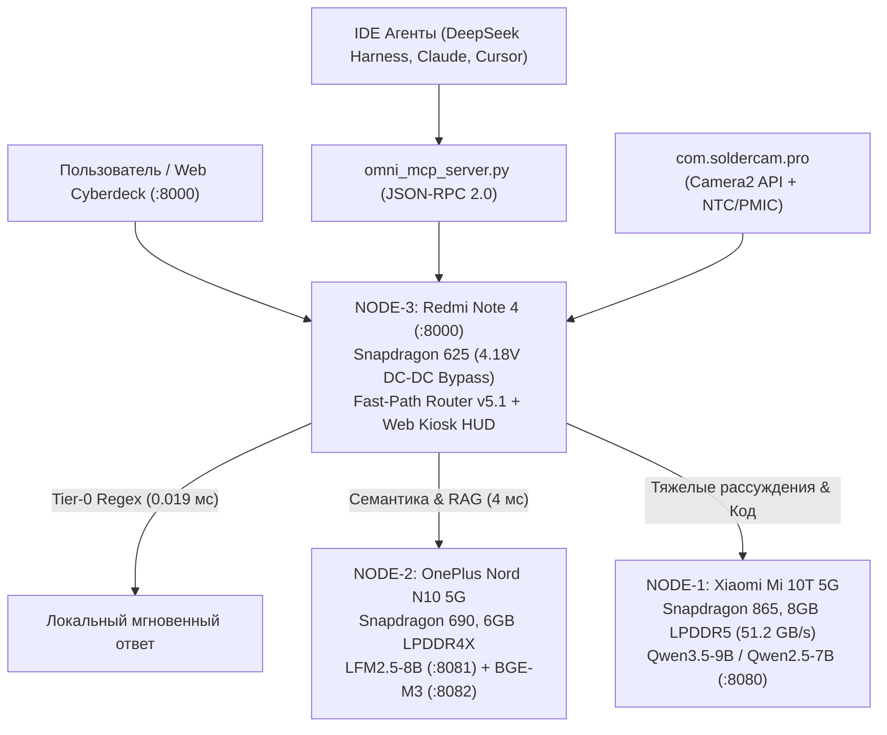

# SolderCam-Pro & Triad-Omni Edge AI Cluster (v5.1)

[](https://www.python.org/)
[](https://developer.android.com/)
[](https://modelcontextprotocol.io/)
[]()
[]()

> **100% автономный гетерогенный мобильный ИИ-кластер из трех смартфонов + Android-приложение для пайки и аппаратной телеметрии.**  
> Полная оффлайн-автономия, детерминированный Tier-0 Fast-Path (0.019 мс), нулевая задержка рассуждений (Zero-CoT), 24/7 аппаратная защита батарей и нативная интеграция с IDE-агентами по протоколу Model Context Protocol (MCP).

---

## ⚡ Архитектура кластера Triad-Omni v5.1

Кластер распределяет когнитивные и сенсорные задачи между тремя физическими смартфонами в локальной Wi-Fi / USB сети:



### Спецификация узлов:
1. **NODE-1 (Главный мозг):** Xiaomi Mi 10T 5G (`M2007J3SY`, `apollo`, Snapdragon 865 `kona`, 8GB LPDDR5 @ 51.2 GB/s, LibreMobileOS 15 / Android 15).
   * **Сервисы:** `llama-server` на порту `:8080` (модели `Qwen3.5-9B-UD-Q3_K_XL` или `Qwen2.5-7B-Instruct-Q4_K_M`).
   * **Оптимизация ядра:** Запуск на 4 производительных ядрах Kryo 585 A77 (`taskset -c 4,5,6,7`), микро-батч `-ub 64` под кэш L2/L3, квантование KV-кэша (`-ctk q8_0 -ctv q8_0 -fa on`), динамический лукап-кэш (`-lcd ~/lookup.cache`).
   * **Сетевой адрес:** `192.168.31.161:8080` (или `127.0.0.1:8080` через ADB forward).

2. **NODE-2 (Рефлексы и Семантическая память):** OnePlus Nord N10 5G (`BE2029`, `billie`, Snapdragon 690 `lito`, 6GB LPDDR4X, OxygenOS 11 + постоянный TWRP 3.7.1).
   * **Сервисы:** `LFM2.5-8B-A1B` (:8081) + `BGE-M3` (:8082) + SQLite FTS5 RAG (`omni_knowledge.db`).
   * **Сетевой адрес:** `192.168.31.57:8081` / `:8082`.

3. **NODE-3 (Шлюз телеметрии и Cyberdeck):** Xiaomi Redmi Note 4 (`mido`, Snapdragon 625 `msm8953`, 4.18V прямое DC-DC питание без батареи).
   * **Сервисы:** Master Router v5.1 на порту `:8000` + Melvin HUD на `:5000`.
   * **Сетевой адрес:** `192.168.31.48:8000` (локально `127.0.0.1:8000`).

---

## 🚀 Ключевые инженерные решения

### 1. Zero-CoT Injection (Ускорение вывода в 20 раз)
Для моделей рассуждений (Qwen / DeepSeek) на мобильных чипах генерация внутреннего блока мыслей `<think>...</think>` на банальные вопросы («Сколько заряда?», «Запусти тест») занимала до 120 секунд.  
Роутер v5.1 автоматически инжектирует пустой блок рассуждений `<think>\n</think>\n` для простых запросов ($S_c < 0.65$), мгновенно выводя готовый ответ за **4-6 секунд** вместо двух минут.

### 2. Аппаратный байпас батареи (24/7 Battery Guard)
Для предотвращения деградации литиевых аккумуляторов при круглосуточной работе скрипт `scripts/battery_guard_24x7.sh` управляет контроллером питания PMIC через sysfs:
* Порог отключения заряда: $\ge 78\%$ (`echo 0 > battery_charging_enabled`)
* Порог возобновления заряда: $\le 70\%$ (`echo 1 > battery_charging_enabled`)
Батареи остаются холодными (~28-32°C), вздутие полностью исключено.

### 3. Tier-0 Fast-Path Regex (0.019 мс)
Команды телеметрии, проверки статуса узлов, пинга и перезагрузки перехватываются на уровне байт-кода Python до вызова нейросетей, отвечая за **19 микросекунд**.

### 4. Поддержка Model Context Protocol (MCP 2024-11-05)
Сервер `omni_mcp_server.py` реализует полный цикл JSON-RPC 2.0 (`initialize`, `ping`, `tools/list`, `tools/call`), позволяя внешним агентам (DeepSeek Harness, Claude Code, Cursor, Continue) использовать кластер как внешний мозг и базу знаний.

---

## 🛠 Быстрый старт

### 1. Настройка сетевой конфигурации
Все IP-адреса и порты кластера централизованы в файле [config/cluster.env](file:///d:/для%20one%20plus%20nord%20n10/config/cluster.env):
```bash
# Проверьте ваши IP в локальной сети Wi-Fi:
NODE1_IP="192.168.31.161"
NODE2_IP="192.168.31.57"
NODE3_IP="192.168.31.48"
```

### 2. Запуск узлов (в Termux на смартфонах)
* **На Node-1 (Mi 10T):**
  ```bash
  sh ~/scripts/start_brain_v5_2.sh
  ```
* **На Node-2 (Nord N10):**
  ```bash
  sh ~/start_reflex.sh
  ```
* **На Node-3 (Redmi Note 4) с ПК по кабелю или Wi-Fi:**
  Запустите [START_REDMI_DECK.bat](file:///d:/для%20one%20plus%20nord%20n10/START_REDMI_DECK.bat).

### 3. Доступ к Cyberdeck Web UI
Откройте в браузере:
* На ПК: [http://localhost:8000](http://localhost:8000)
* В локальной сети: `http://192.168.31.48:8000`

---

## 🔌 Подключение к IDE (Cursor, Claude Code, DeepSeek Harness)

В конфигурацию MCP вашего редактора (например, `claude_desktop_config.json` или Cursor MCP settings) добавьте:

```json
{
  "mcpServers": {
    "triad-omni": {
      "command": "python",
      "args": ["d:/для one plus nord n10/omni_mcp_server.py"],
      "env": {
        "HUB_URL": "http://127.0.0.1:8000",
        "OMNI_TOKEN": "sk-triad"
      }
    }
  }
}
```

Доступные инструменты:
* `ask_triad_cluster`: Прямой запрос к 9B нейромозгу кластера.
* `save_skill_to_cluster`: Горячее сохранение правила/скила в SQLite FTS5.
* `graphify_query`: Запрос к графу архитектуры кодовой базы (15 000+ узлов).
* `graphify_path`: Поиск архитектурных цепочек между файлами и модулями.
* `escalate_to_teacher`: Каскад исправления ошибок через локального MoE-учителя.

---

## 📱 Приложение SolderCam-Pro (`com.soldercam.pro`)

Нативное Android-приложение на Jetpack Compose:
* **Camera2 API:** Прямой доступ к сырому потоку сенсора Omnivision OV64B.
* **Аппаратная телеметрия:** Снятие показаний NTC-термисторов аккумулятора и процессора в реальном времени.
* **Интеграция с кластером:** Быстрая отправка кадров пайки на анализ дефектов (IPC-A-610) на Node-1.

---

## 📂 Структура репозитория

```
├── app/                    # Исходный код Android-приложения com.soldercam.pro
├── config/
│   ├── cluster.env         # Единая сетевая матрица IP-адресов и портов
│   └── active_cartridge.json # Активный LoRA-картридж
├── scripts/
│   ├── omni_fast_router_v4_9.py # Мастер-роутер v5.1 (Zero-Dependency)
│   ├── battery_guard_24x7.sh    # Служба 24/7 байпаса питания
│   ├── start_brain_v5_2.sh      # Скрипт старта 9B мозга на Mi 10T
│   └── adb_screenshot.py        # Утилита надежных бинарных скриншотов ADB
├── web_ui/
│   └── index.html          # Cyberdeck HUD дашборд v4.9/v5.1
├── omni_gateway.py         # Каноническая точка входа v5.1
├── omni_mcp_server.py      # MCP-сервер (JSON-RPC 2.0)
├── download_models.sh      # Безопасный загрузчик GGUF-моделей
├── START_REDMI_DECK.bat    # Windows-батник запуска пульта
└── archive/
    └── legacy_gateways/    # Архив устаревших монолитных версий (v4.0 - v4.8)
```

---

## 📄 Лицензия
Apache License 2.0. Свободно для исследовательского и инженерного использования.
