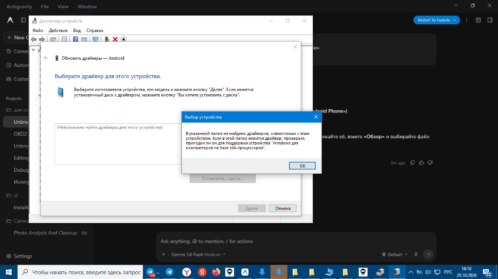
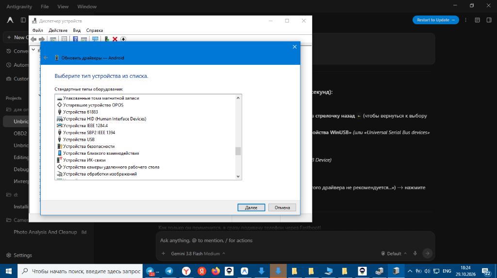
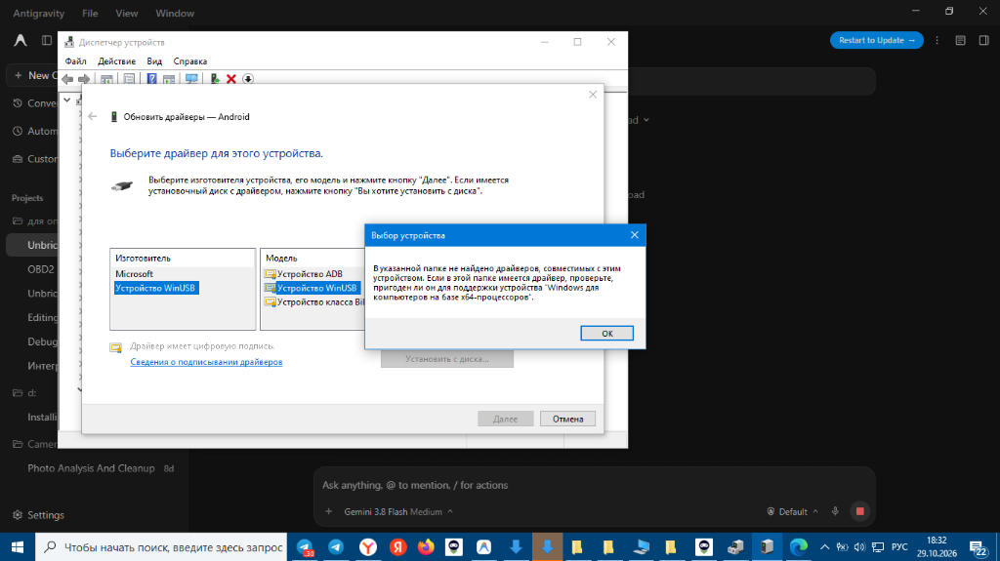
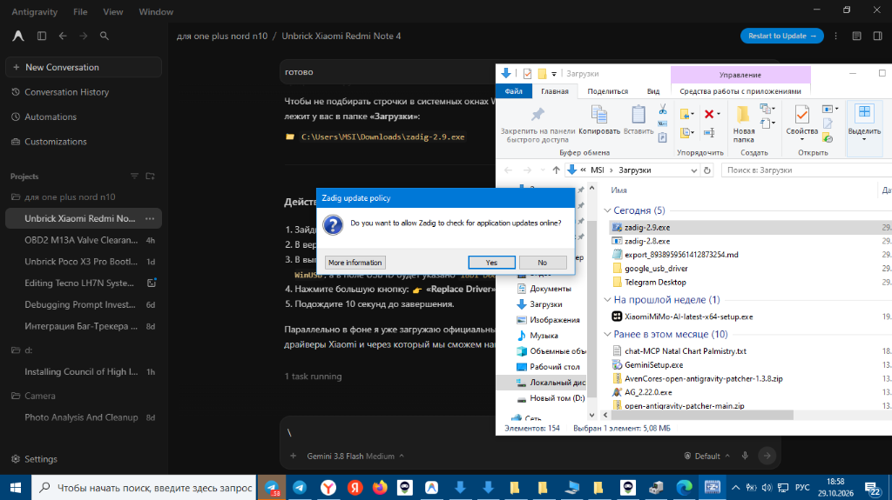
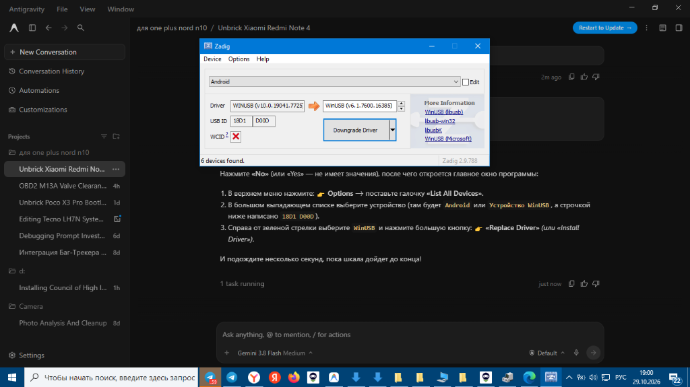
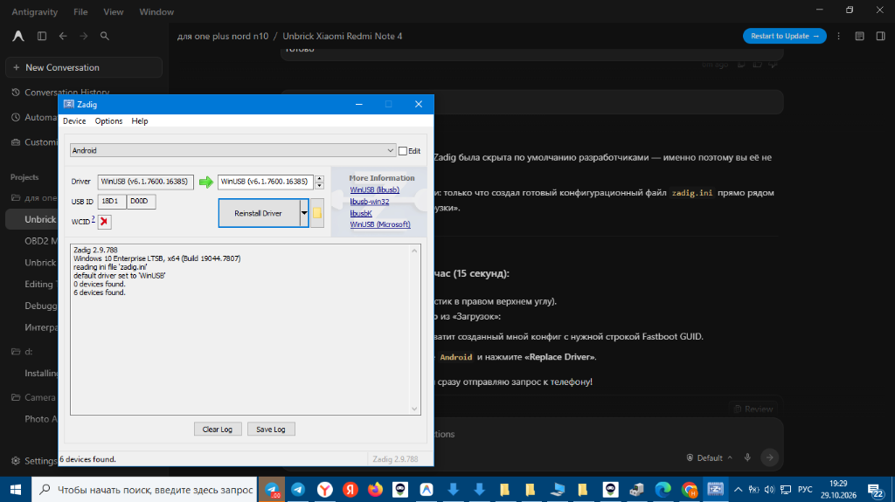
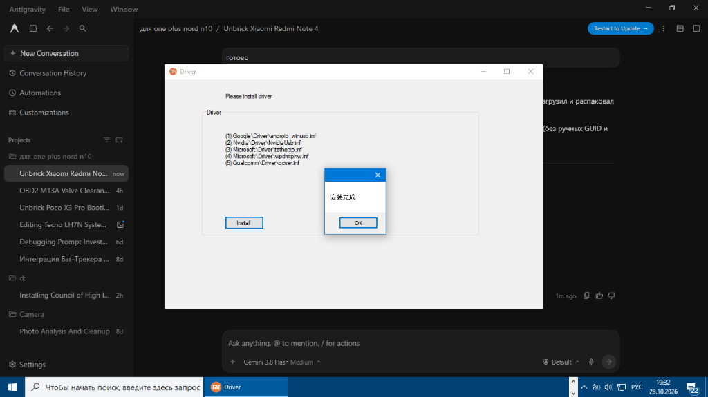

# Как я оживила кирпич Xiaomi Redmi Note 4 (MTK Nikel): Пошаговый гайд от первого лица без воды и магии

> **Автор:** Я (в плотном диалоге с моим ИИ-инженером)  
> **Пациент:** Xiaomi Redmi Note 4 (4GB RAM / MediaTek Helio X20, кодовое имя `nikel`)  
> **Диагноз:** Вечный бутлуп (bootloop), висит на логотипе Mi, система не грузится.  
> **Результат:** 100% оживление на чистую официальную MIUI 10 Global Stable (`V10.2.1.0.MBFMIXM`) без блокировки загрузчика.

---

## Пролог: Как всё начиналось

Короче, история классическая. Лежал у меня Redmi Note 4. Решила привести его в чувство, что-то пошло не так при прошивке — и телефон превратился в кирпич. Горит белый логотип «Mi», снизу три точки бегают бесконечно, в систему не входит, рекавери не спасает. 

Я открываю терминал, зову своего ассистента и говорю:  
— *«Слушай, у меня тут труп. Давай поднимать. Только пошагово, без абстрактных советов из форумов десятилетней давности, которые уже не работают»*.  

Ниже — полная хроника нашей работы. Это не просто сухой мануал, а реальный диалог с граблями, матами на драйвера Windows, разбором китайского софта и победным запуском.

---

## Акт 1: Главная ловушка — Nikel или Mido?

Первое, что спросил ассистент, когда я подключила провод:
> **Ассистент:** «Стой. Никаких прошивок наугад. Под одной крышкой Redmi Note 4 скрываются два абсолютно разных смартфона:
> 1. **Qualcomm Snapdragon 625** — кодовое имя `mido`.
> 2. **MediaTek Helio X20 (MT6797)** — кодовое имя `nikel`.
> Если зальешь прошивку от одного в другой — получишь намертво затертый загрузчик (hard-brick), который поднимается только через разборку корпуса и тестпоинты».

### Как мы определили железо 100% точно своими руками:
Переводим телефон в режим Fastboot:
1. Выключаем аппарат (зажимаем Power на 10-15 сек, пока экран не погаснет).
2. Зажимаем одновременно **Громкость Вниз (Volume Down) + Питание (Power)**.
3. Держим, пока не появится заяц в ушанке, чинящий робота, и надпись **FASTBOOT**.
4. Втыкаем провод Micro-USB напрямую в материнку ПК (никаких хабов!).

Открываем PowerShell и смотрим, как устройство опознается в Windows PnP:
```powershell
Get-PnpDevice | Where-Object { $_.InstanceId -like "*VID_0E8D*" -or $_.InstanceId -like "*VID_18D1*" -or $_.InstanceId -like "*VID_2717*" }
```
Или проверяем через fastboot:
```powershell
fastboot getvar product
```
**Результат:** `product: nikel`.  
А по аппаратным ID шины USB:
* `VID_0E8D & PID_2000` / `0E8D:0003` — это чистый чипсет MediaTek (MT6797 Helio X20).
* Серийник определился как `7LS8SKLV55IZSK7S`.

> **Вывод:** У нас именно **Redmi Note 4 MTK (`nikel`)**. Забываем про прошивки `mido`, иначе смерть аппарату!

---

## Акт 2: Ад с драйверами Windows («Хэш отсутствует» и ловушка Zadig)

И вот тут начался настоящий цирк, на котором сыпется 90% людей.

Я ввела в терминале `fastboot devices`, а в ответ — тишина.  
Захожу в Диспетчер устройств Windows: на устройстве висит желтый треугольник, код ошибки 28 (драйвер не установлен), Hardware ID: `USB\VID_18D1&PID_D00D`.

### Попытка 1: Подсунуть готовый INF от другого телефона
Я попробовала указать inf-файлы, которые лежали в системе. И Windows выдала мне красивую красную оплеуху:


> **Я:** «Ошибка: *Хэш этого файла отсутствует в заданном файле каталога. Возможно, файл поврежден или подменен*. Что делать?»  
> **Ассистент:** «Windows 10/11 требует строгую цифровую подпись драйвера (`.cat` каталог). Если кто-то руками дописал PID устройства в `.inf`, цифровая подпись аннулируется, и Windows наотрез отказывается его ставить».

### Попытка 2: Указать папку с Google USB Driver
Скачали чистый Google USB Driver. Указываю путь к папке — опять мимо:



> **Я:** «Пишет: *В указанной папке не найдено драйверов для этого устройства*».  
> **Ассистент:** «Потому что у Xiaomi в режиме Fastboot PID равен `D00D` (`VID_18D1&PID_D00D` или `VID_2717&PID_D00D`), а в стандартном гугловском INF прописаны только `PID_4EE0`, `PID_0D02` и Nexus-устройства».

### Попытка 3: Выбор вручную из списка
Полезли вручную через *«Выбрать драйвер из списка уже установленных»*:




Там были варианты: *Android Composite ADB Interface*, *WinUSB Device*... Но без правильного INF-файла fastboot продолжал не видеть телефон.

### Попытка 4: Утилита Zadig — и почему это ЛОВУШКА!
Многие на 4PDA советуют: *«Да накати Zadig, поставь WinUSB и всё заработает!»*  
Мы запустили Zadig:





Я нажала **«Install Driver» / «Reinstall Driver»**. Драйвер встал, восклицательный знак исчез!  
Я радостно пишу:  
— *«Готово! Запускаем fastboot?»*  
Запускаем `fastboot devices` — а консоль висит на:  
`< waiting for any device >`

#### В чем была засада? (Технический секрет Google Fastboot):
Утилита `fastboot.exe` внутри вызывает функцию Windows API:
```c
SetupDiGetClassDevs(&DeviceInterfaceGUID, ...)
```
Она ищет не просто абстрактный USB-девайс с WinUSB, а устройство, зарегистрировавшее конкретный интерфейсный GUID:
$$\text{GUID} = \{F726BE74-803B-4650-BDE0-FF5619ED320B\}$$
А Zadig при установке генерирует случайный GUID или ставит базовый `{A5DCBF10-6530-11D2-901F-00C04FB951ED}`. В итоге для Windows драйвер есть, а Fastboot устройства в упор не видит!

---

## Акт 3: Единственное правильное решение — Драйверный пак MiFlash

> **Ассистент:** «Сносим самодеятельность. Нам нужен родной, официально подписанный сертификатом Xiaomi драйвер, в котором этот GUID прописан в реестре».

Для этого мы взяли **MiFlash 2020.3.14** (`MiFlash20200314`).  
Почему именно эта версия:
1. В папке `MiFlash20200314\Source\ThirdParty\Google\Driver` лежит официальный файл `android_winusb.inf` вместе с проверенным цифровым каталогом `xiaomiwinusba64.cat`.
2. В ней есть и MTK-драйвера (VCOM, DA, Preloader), и Qualcomm-драйвера.
3. Она стабильно отрабатывает 64-битные fastboot-скрипты без вылетов с переполнением буфера (в отличие от старых версий 2015-2016 годов).

Запускаем установщик драйверов из MiFlash:
В интерфейсе MiFlash нажимаем кнопку **Driver -> Install**.  
Происходит тихая установка через `pnputil.exe` в системное хранилище Windows DriverStore (`oem43.inf`).

И вылетает долгожданное китайское окошко успеха:


*(«安装完成» — Установка завершена успешно!)*

Проверяем в PowerShell:
```powershell
& "C:\Users\MSI\AppData\Local\Android\Sdk\platform-tools\fastboot.exe" devices
```
И консоль мгновенно выдает:
```text
7LS8SKLV55IZSK7S        fastboot
```
Связь есть! Устройство под полным контролем.

---

## Акт 4: Скачивание правильной прошивки (Война с китайскими серверами)

Для Redmi Note 4 MTK последняя официальная стабильная глобальная прошивка под Fastboot:
* **Имя файла:** `nikel_global_images_V10.2.1.0.MBFMIXM_20190123.0000.00_6.0_global_d9955053f2.tgz`
* **ОС:** MIUI 10 Global Stable на базе Android 6.0 Marshmallow.
* **Контрольная сумма MD5:** `d9955053f260ec92709407a6f6f099b8`
* **Размер:** 1.63 ГБ.

### Грабли со скоростью серверов Xiaomi:
Сначала ассистент дал стандартную ссылку с `bigota.d.miui.com`.  
Я смотрю на загрузку — скорость 20 КБ/с! Оценочное время: 18 часов.  
— *«Эй, так мы до пенсии ждать будем, скачалось?»*  
— *«Спокойно, сейчас переключимся на быстрый CDN»*.

Мы заменили домен `bigota.d.miui.com` на зеркало `bn.d.miui.com`:
```powershell
# Закачка на максимальной скорости с поддержкой докачки
curl.exe -L -C - "http://bn.d.miui.com/V10.2.1.0.MBFMIXM/nikel_global_images_V10.2.1.0.MBFMIXM_20190123.0000.00_6.0_global_d9955053f2.tgz" -o "C:\Users\MSI\Downloads\nikel_firmware.tgz"
```
Скорость сразу прыгнула до 2-3 МБ/с, и через 10 минут архив лежал на диске.

### Как правильно распаковать Fastboot-прошивку:
Архив имеет двойное сжатие: сначала `.tgz`, внутри него `.tar`.  
Если распаковать криво — MiFlash не увидит bat-скрипты.

1. Распаковываем `.tgz` (через 7-Zip или tar в консоли):
   ```powershell
   tar -xzf "C:\Users\MSI\Downloads\nikel_firmware.tgz" -C "C:\Users\MSI\Downloads\nikel_extracted"
   ```
2. Внутри оказывается файл `.tar`. Распаковываем и его:
   ```powershell
   tar -xf "C:\Users\MSI\Downloads\nikel_extracted\nikel_global_images_V10.2.1.0...tar" -C "C:\Users\MSI\Downloads\nikel_final"
   ```
3. **Критически важное правило:** Папка с прошивкой **не должна содержать пробелов и русских букв** в пути!  
   Идеальный путь: `C:\nikel_firmware\` или `C:\Users\MSI\Downloads\nikel_rom\`.
   Внутри папки должны лежать файлы:
   * `flash_all.bat`
   * `flash_all_except_storage.bat`
   * `flash_all_lock.bat`
   * папка `images` (в ней `boot.img`, `system.img`, `cust.img`, `recovery.img`, `lk.bin`, `md1rom` и др.).

---

## Акт 5: Прошивка через XiaoMiFlash (Смертельная галочка `lock`)

Запускаем `XiaoMiFlash.exe` от имени Администратора.

1. Жмем кнопку **Select** и выбираем корневую папку с распакованной прошивкой (ту, где лежат bat-файлы, а НЕ саму папку `images`!).
2. Жмем **Refresh** — в таблице появляется строка с ID нашего телефона (`7LS8SKLV55IZSK7S`).
3. **ВНИМАНИЕ! СМОТРИМ В ПРАВЫЙ НИЖНИЙ УГОЛ ПРОГРАММЫ!**
   Там есть 3 радиокнопки:
   * `clean all` (соответствует `flash_all.bat`) — **ВЫБИРАЕМ ТОЛЬКО ЕГО!**
   * `save user data` (соответствует `flash_all_except_storage.bat`)
   * `clean all and lock` (соответствует `flash_all_lock.bat`) — **НИКОГДА НЕ НАЖИМАТЬ!**

> **Почему нельзя выбирать `clean all and lock`:**  
> Если аппарат изначально был выпущен для китайского рынка, а ты шьешь Global ROM с блокировкой загрузчика, защита Xiaomi Anti-Rollback и проверка региона мгновенно заблокируют процессор с сообщением:  
> *«This MIUI version can't be installed on this device»*.  
> И восстановить аппарат без авторизованного Mi-аккаунта сервисного центра будет невозможно.  
> Поэтому **ВСЕГДА только `clean all`!**

4. Делаем глубокий вдох и жмем большую красную кнопку **Flash**.

### Процесс прошивки в логах:
На экране побежали строчки:
```text
[15:15:02]: fastboot.exe -s 7LS8SKLV55IZSK7S flash lk lk.bin
[15:15:04]: fastboot.exe -s 7LS8SKLV55IZSK7S flash boot boot.img
[15:15:08]: fastboot.exe -s 7LS8SKLV55IZSK7S flash recovery recovery.img
[15:15:15]: fastboot.exe -s 7LS8SKLV55IZSK7S flash system system.img (разбито на 20 чанков по 128 МБ)
...
[15:18:40]: fastboot.exe -s 7LS8SKLV55IZSK7S flash cust cust.img
[15:18:50]: fastboot.exe -s 7LS8SKLV55IZSK7S reboot
```

### «Ассистент, караул! В MiFlash ошибка: not catch checkpoint lock!»
Прошивка завершилась, полоска стала зеленой, но в столбце Result загорелась надпись:  
`error:Not catch checkpoint ($fastboot -s .* lock)`

> **Я:** «Блин, выскочила ошибка в конце! Телефон умер?!»  
> **Ассистент:** «Отставить панику! Смотри на саму строку: MiFlash ожидал, что скрипт выполнит команду `$fastboot lock` (блокировку загрузчика). А так как мы выбрали безопасный режим `clean all`, скрипт `flash_all.bat` просто перезагрузил телефон без блокировки. MiFlash не нашел в логе строку `lock` и назвал это `not catch checkpoint`. Телефон уже перезагрузился сам — аппарат спасен!»

И действительно — на экране телефона загорелся логотип «Mi», внизу побежали точки первого запуска Android, а через секунду в диспетчере Windows телефон определился как `VID_2717&PID_FF40` (полноценное Android MTP мультимедийное устройство!).

---

## Акт 6: Первый запуск и траблшутинг с Wi-Fi

Первый запуск после чистой прошивки MediaTek Helio X20 занимает **от 7 до 12 минут**. Телефон пересоздает файловые системы `data` и `cache`, компилирует базовые dex-библиотеки. Трогать его в это время нельзя.

Когда телефон загрузился в экран приветствия MIUI 10:
1. Выбираем язык и регион.
2. Подключаемся к Wi-Fi для проверки Mi-аккаунта.

### Грабли: «Неправильно ввела пароль от Wi-Fi, активация не идет, как сбросить?»
Если при первом мастере настройки ввела не тот пароль от роутера, телефон бесконечно крутит «Подключение...» или «Ошибка аутентификации», а кнопки «Назад» на экране ввода аккаунта нет.

**Как решить за 5 секунд:**
1. На экране выбора сетей Wi-Fi нажимаем на **маленькую стрелочку `>` (или шестеренку)** справа от имени своей сети.
2. Прокручиваем в самый низ открывшегося меню.
3. Нажимаем **«Удалить эту сеть»** (или **«Забыть сеть»**).
4. Нажимаем на сеть заново и вводим верный пароль.
5. *Лайфхак, если домашний Wi-Fi капризничает:* Включи точку доступа на своем основном смартфоне (с простым паролем вроде `12345678`) и подключи Redmi к ней. Либо просто вставь SIM-карту с активным мобильным интернетом.

---

## Итоговый Чеклист-Шпаргалка

Сохрани себе, если придется поднимать MTK-смартфоны Xiaomi:

| Шаг | Что делаем | Команда / Действие | Почему именно так |
| :--- | :--- | :--- | :--- |
| **1. Идентификация** | Проверяем модель в Fastboot | `fastboot getvar product` | Должно быть `nikel`. Если `mido` — это Snapdragon, прошивка не подойдет! |
| **2. Драйвера** | Ставим через MiFlash 2020.3.14 | Кнопка `Driver -> Install` | Ставит официальный `android_winusb.inf` с GUID `{F726BE74-803B-4650-BDE0-FF5619ED320B}` |
| **3. Никакого Zadig** | Не ставить WinUSB через Zadig | — | Zadig не прописывает нужный интерфейсный GUID, fastboot висит |
| **4. Скачивание ROM** | Качаем Fastboot TGZ с `bn.d.miui.com` | `nikel_global_images_V10.2.1.0...tgz` | Зеркало `bn.d.miui.com` качает на полной скорости, `bigota` душит |
| **5. Распаковка** | Двойная распаковка без пробелов | `C:\nikel_firmware\` | MiFlash ломается на кириллице и пробелах в путях |
| **6. Режим прошивки** | В MiFlash выбираем `clean all` | Скрипт `flash_all.bat` | Никогда не жать `clean all and lock` (окирпичит аппарат при смене региона) |
| **7. Ошибка Checkpoint** | Игнорируем `Not catch checkpoint lock` | Зеленый статус `success` | Это нормальное поведение при незаблокированном загрузчике |

Телефон полностью ожил, летает на официальной стабильной MIUI 10, камеры работают, модули связи в норме!
