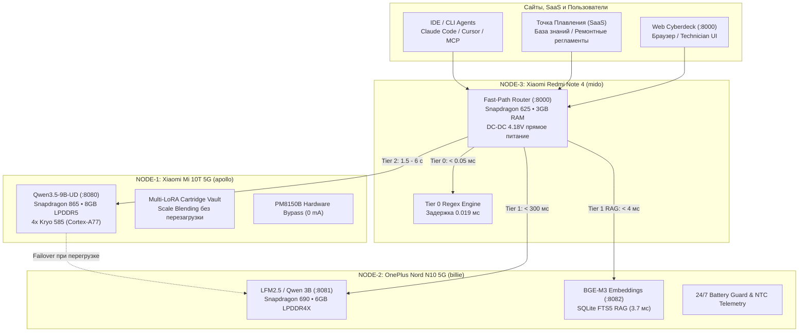
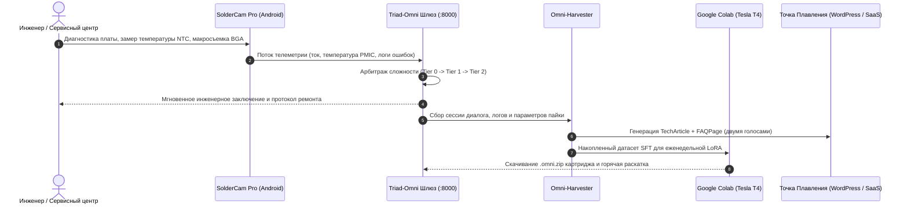

# 🛰️ Triad-Omni & Melvin: Гетерогенный Edge AI Кластер, Интеграция в Веб-Сайты и Непрерывное Обучение

> **Версия архитектуры:** Triad-Omni v5.2 / SolderCam Pro / Точка Плавления  
> **Статус:** Эталонный манифест проекта, технический регламент сбора датасетов и реестр стандартов  
> **Авторский стандарт:** Practico Editorial Standard (Редакция 2, `USER_VOICE_STYLE_GUIDE.md`)

---

## 1. Концепция и Философия Проекта (Answer First)

Я построила полностью автономный гетерогенный ИИ-кластер **Triad-Omni** на базе трех отслуживших физических смартфонов, превратив вторичный кремний в распределенный вычислительный комплекс. Вся система работает **на 100% локально**, без облачных API, без аренды чужих серверов и без риска блокировок или утечки закрытых инженерных данных.

### Три вычислительных столпа кластера:


* **NODE-1 (Главный Нейромозг):** Xiaomi Mi 10T 5G (`M2007J3SY`, `apollo`, Snapdragon 865, 8GB LPDDR5, LibreMobileOS 15). Отвечает за глубокие рассуждения, декомпиляцию, генерацию кода и анализ схемотехники на порту `:8080`. Аппаратный сквозной байпас питания через PMIC PM8150B (`charging_enabled=0`).
* **NODE-2 (Рефлексы и Семантика):** OnePlus Nord N10 5G (`BE2029`, `billie`, Snapdragon 690, 6GB LPDDR4X, OxygenOS 11). Мгновенный оффлайн-поиск по SQLite FTS5 RAG за **~3.7 мс**, эмбеддинги `BGE-M3` на `:8082` и быстрый диалог на `:8081`. Защита батареи SMB1355.
* **NODE-3 (Аппаратный Диспетчер и Шлюз):** Xiaomi Redmi Note 4 (`mido`, Snapdragon 625, DC-DC прямое питание 4.18V без батареи). Фильтрация команд за 0.019 мс, роутер сетей на порту `:8000` и выдача On-Screen HUD.

---

## 2. Архитектура внедрения агента в веб-проекты («Точка Плавления»)

Агент внедряется в медиа-портал и SaaS-экосистему **«Точка Плавления»** не как банальный чат-бот, а как **автономный конвейер полного цикла**:



### 2.1. Концепция двух голосов (Dual-Voice Architecture)
Контент и диагностические выводы генерируются двумя взаимодополняющими голосами по стандарту *Practico Редакция 2*:
1. **Practico 1 (Инженер-диагност «с паяльником и осциллографом»):**
   * *Позиция:* Внимательный практик за верстаком.
   * *Грамматика:* Строго первое лицо в **женском роде прошедшего времени** («проверила», «раскопала», «измерила», «пропаяла», «вывела»).
   * *Принцип объяснения:* **Факт $\to$ Механизм на уровне кремния/физики $\to$ Практическое последствие**.
   * *Табу:* Нулевая терпимость к «воде», канцеляриту («в данной статье мы рассмотрим...»), псевдоэкспертному высокомерию и бытовым аналогиям с борщом и кастрюлями.
2. **Practico 2 (Заказчик / Руководитель сервиса):**
   * *Фокус:* Стоимость восстановления узла, предотвращение гарантийного возврата, рентабельность компонентного ремонта против крупноузловой замены платы.

### 2.2. Генерация семантической микроразметки (Schema.org & GEO)
Для попадания в Rich Snippets поисковиков (Google, Yandex) и цитирования генеративными движками (Perplexity, ChatGPT, Gemini) агент автоматически обогащает каждую страницу структурированными данными JSON-LD:
* **`TechArticle`:** Полный паспорт технологического процесса со ссылками на действующие ГОСТы, применяемые припои и флюсы.
* **`FAQPage`:** Реальные диагностические развилки (*«Почему плата циклически перезагружается при нагреве выше 45°C?»*).
* **`SoftwareApplication`:** Паспорт SolderCam Pro с версией APK, целевым SDK 35 и минимальными аппаратными требованиями.

---

## 3. Непрерывное обучение: Что нейросети должны собирать в продакшене

Для исключения «катастрофического забывания» и постоянного роста экспертности кластер использует еженедельный цикл дообучения через легковесные **LoRA-картриджи (~45–150 МБ)**.

```mermaid
flowchart LR
    subgraph Capture["1. Сбор в продакшене"]
        D1["Диагностика плат<br/>& NTC-термисторы"]
        D2["Реальные Q&A сессии<br/>мастеров сервиса"]
        D3["Логи сбоев ядра,<br/>SELinux & троттлинга"]
    end

    subgraph OTK["2. Фильтрация и ОТК"]
        F1["Brand Voice Analyzer<br/>(проверка авторского стиля)"]
        F2["Standards Verifier<br/>(проверка ГОСТ / IPC)"]
        F3["CoT Classifier<br/>(Sc < 0.65 vs Sc >= 0.65)"]
    end

    subgraph Colab["3. Тренировка в Colab"]
        T4["Tesla T4 GPU (16GB)<br/>Unsloth QLoRA 4-bit"]
        GGUF["Конвертация в<br/>adapter.gguf (~45MB)"]
    end

    subgraph Deploy["4. Развертывание"]
        Zip[".omni.zip картридж"]
        Hot["Hot-Swap в ОЗУ Mi 10T<br/>Zero Reload • Scale 0.0 - 1.0"]
    end

    Capture --> OTK
    OTK -->|Master Accumulated SFT| Colab
    Colab --> GGUF
    GGUF --> Zip
    Zip --> Hot
```



### 3.1. Структура собираемых данных
Демон сбора `omni_harvester.py` непрерывно логирует следующие категории событий:
1. **Аппаратная телеметрия PMIC и термопрофили:**
   * Напряжения линий питания ($V_{\text{core}}$, $V_{\text{mem}}$, $V_{\text{io}}$);
   * Показания термисторов аккумулятора и датчиков кристалла;
   * Точки входа SoC в троттлинг при длительных сессиях пайки феном.
2. **Диагностические пары «Симптом $\to$ Причина $\to$ Решение»:**
   * Реальные случаи из мастерской: прогар шины питания, трещины BGA-шаров, отвал сокета, деградация фильтрующих конденсаторов.
3. **Цепочки рассуждений (CoT-трассировки):**
   * Для задач с коэффициентом сложности $S_c \ge 0.65$ логируется полный путь аналитического поиска неисправности.
   * Для простых запросов ($S_c < 0.65$) формируются сжатые Zero-CoT пары для мгновенного отклика.

### 3.2. Автоматический ОТК-скоринг датасета
Перед отправкой в Colab каждая пара проходит тройной фильтр:
1. **Проверка по `brand_voice_analyzer.py`:** женский род глаголов, отсутствие стоп-фраз («идеальный результат», «проще простого», «секретный секрет»).
2. **Верификация нормативной базы:** сверка наименований сплавов (ПОС 61, SAC305) и флюсов с Реестром стандартов.
3. **Дедупликация по хэшу SHA-256:** удаление повторяющихся запросов.

---

## 4. Сводный реестр стандартов, ГОСТов и спецификаций

Экосистема базируется на строгих государственных и международных инженерных регламентах:

### 4.1. Пайка, сплавы и химия монтажа
| Норматив | Статус | Область применения | Ключевые требования |
| :--- | :--- | :--- | :--- |
| **ГОСТ 21930-76** | Действующий | Припои оловянно-свинцовые в чушках | Чистота сплавов ПОС 61 ($T_{sol}=183^\circ\text{C}, T_{liq}=190^\circ\text{C}$), ПОС 63, ПОССу |
| **ГОСТ 21931-76** | Действующий | Припои оловянно-свинцовые в изделиях | Трубки с канифолью 1–5 каналов (доля флюса 1.0–3.5%), проволока |
| **ГОСТ Р ИСО 9453-2014** | Действующий | Припои мягкие (ISO 9453) | Бессвинцовые сплавы SAC305 ($217–219^\circ\text{C}$), низкотемпературный Sn42Bi58 ($138^\circ\text{C}$) |
| **IPC J-STD-004D** | Международный | Требования к паяльным флюсам | Категории ROL0 и REL0 (безотмывочные, диэлектрические, без свободных галогенидов) |
| **IPC J-STD-005B** | Международный | Паяльные пасты для SMT | Гранулометрия Type 3 (25–45 мкм) и Type 4 (20–38 мкм) под BGA-монтаж |
| **IPC J-STD-006C** | Международный | Припои электронного класса | Допуски по примесям: Al < 0.005%, Cd < 0.002%, Fe < 0.02% |

### 4.2. Контроль качества и дефектоскопия
| Норматив | Область применения | Критерии приемки |
| :--- | :--- | :--- |
| **ГОСТ Р 56427-2022** | Пайка электронных модулей | Требования к смачиваемости контактных площадок, галтели припоя |
| **IPC-A-610J** | Критерии электронных сборок | Класс 1 (бытовая РЭА), Класс 2 (промышленная), Класс 3 (специальная/медицинская надежность) |
| **IPC-7095E** | Реализация и монтаж BGA/LGA | Пустоты в паяных шарах (Voiding) не более 15% площади пятна контакта |

### 4.3. Охрана труда, ESD и документация
* **ГОСТ 12.3.003-86:** Безопасность паяльных работ, локальная вытяжная вентиляция с фильтрацией аэрозолей свинца и канифольного дыма.
* **ГОСТ IEC 61340-5-1-2019:** Защита электронных устройств от электростатических явлений (ESD-браслеты, антистатические коврики с сопротивлением утечки $10^6–10^9$ Ом).
* **ГОСТ 2.601-2019:** Единая система конструкторской документации (ЕСКД). Эксплуатационные документы и ремонтные формуляры.

### 4.4. Программные и протокольные стандарты
* **Model Context Protocol (MCP 2024-11-05):** Стандарт подключения инструментов кластера к внешним ИИ-агентам.
* **Schema.org v24.0:** Микроразметка `TechArticle`, `FAQPage`, `HowTo` для семантической паутины.
* **OpenAPI 3.1:** Спецификация REST эндпоинтов шлюза (`/api/query`, `/api/telemetry`, `/api/cluster/status`).

---

## 5. Регламент развертывания и управления

1. **Запуск аппаратного шлюза:**
   ```bash
   python scripts/omni_fast_router_v4_9.py
   ```
2. **Проверка статуса кластера по ADB:**
   ```bash
   adb devices -l
   python scripts/test_fast_router.py
   ```
3. **Синхронизация базы знаний графа:**
   ```bash
   graphify update .
   ```
4. **Горячая загрузка картриджа через API:**
   ```bash
   curl -X POST http://192.168.31.57:8000/api/cartridge/upload \
     -H "X-Filename: solder_v2.omni.zip" \
     --data-binary @solder_v2.omni.zip
   ```

Кластер Triad-Omni и агент Melvin доказывают: распределенный оффлайн-ИИ промышленного класса на базе старых смартфонов — это реальная, экономически эффективная и независимая инженерная реальность.
